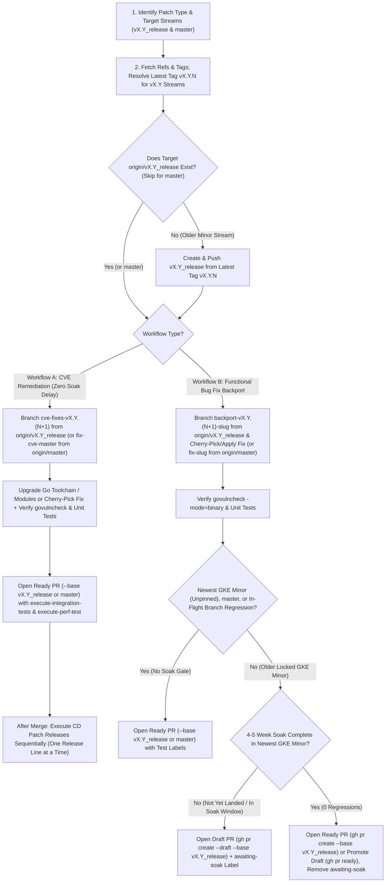

# GCSFuse Release Branch CVE Patching & Backport Skill

This skill provides a standardized, end-to-end workflow for landing patch releases (`v<major>.<minor>.<N+1>`) onto persistent GCSFuse minor release branches (`v<major>.<minor>_release`, e.g., `v2.11_release`, `v3.2_release`, `v3.5_release`, `v3.8_release`, `v3.11_release`, `v3.12_release`) as well as `master`.

All patch releases for a `<major>.<minor>` series land directly on the single persistent minor release branch **`v<major>.<minor>_release`**. This skill covers both release-branch backport workflows defined by the GCSFuse release branching strategy:
- **Workflow A: CVE Remediation (Zero Soak Delay — Multi-Branch Fan-Out)**: Exempt from soak requirements. CVE fixes can be applied, verified (`govulncheck -mode=binary` + unit tests), opened as PRs, and merged across all active `v<major>.<minor>_release` branches (and `master`) in parallel with zero soak delay; however, actual patch releases must be executed sequentially **one release line at a time** (because the CD release pipeline supports only one in-flight release at a time and concurrent or interleaved runs overwrite shared state such as `details.txt` and static `release-test-*` GCE VMs).
- **Workflow B: Functional Bug Fix Backport (No Soak Gate on Newest GKE Line; 4–5 Week Soak Gate on Older Locked Branches)**: The fix lands on the newest GKE line first with **no soak gate**, because that is where the soak happens. It must then complete a mandatory **4–5 week soak** in that newest GKE minor release stream (with zero regressions) before being merged into any **older locked** `v<major>.<minor>_release` branch (on older locked branches, backports may be staged early as a Draft PR with the `awaiting-soak` label).

## Related Skills
- **[GCSFuse Minor Release Branch Creation Skill](../minor-release-branch/SKILL.md)**: Cutting a new persistent minor release branch (`v<major>.<minor>_release`) from `master` or a specified commit.
- **[GCSFuse Dependency Upgrading Skill](../dep-upgrade/SKILL.md)**: Core rules for querying latest stable module versions, major version upgrade safety checks, Go version file locations, and `go mod tidy` hygiene.
- **[GCSFuse Pull Request Creation Skill](../pull-request/SKILL.md)**: Conventional Commits title standards and PR body template formatting.
- **[GCSFuse Build and Style Verification Skill](../build/SKILL.md)**: Local compilation and formatting verification checks.



---

## Workflow A: CVE Remediation (Zero Soak Delay — Multi-Branch Fan-Out)

CVE remediations are **exempt from soak requirements**. Because persistent `v<major>.<minor>_release` branches are kept free of un-soaked functional changes, Git and GitHub preparation—applying fixes, verifying with `govulncheck -mode=binary` and unit tests, opening PRs, and merging—can proceed across all active `v<major>.<minor>_release` branches (and `master`) in parallel with zero soak delay. However, **actual patch releases must be executed sequentially one release line at a time**: the CD release pipeline supports only one in-flight release at a time, and parallel or interleaved release runs overwrite shared pipeline state (such as `details.txt` and static `release-test-*` GCE VMs).
> [!NOTE]
> **EOL Policy**: A `v<major>.<minor>_release` branch reaches End of Life (EOL) 2 years after the release of the last GKE minor version that depends on it. Only patch active (non-EOL) release streams.

### Phase A1: Triage & Release Stream Discovery

#### A1.1 Parse CVE Advisory & Target Streams
From the user prompt or security advisory / issue tracker ticket:
1. Identify all affected release streams (e.g., `v2.11`, `v3.2`, `v3.5`, `v3.8`, `v3.11`, `v3.12`) and `master` (always inspect `origin/master` as well—even when an advisory only lists released versions—so `master` is updated alongside active release branches whenever it does not yet contain the fix).
2. Identify each vulnerable package or toolchain component and its minimum fixed version:
   - **Go Modules**: e.g., `google.golang.org/grpc >= v1.83.2`, `go.opentelemetry.io/otel/sdk >= v1.45.0`.
   - **Go Toolchain / Standard Library**: e.g., `stdlib` CVEs requiring `Go >= 1.26.9`.

#### A1.2 Discover Latest Release Tags and Persistent Minor Release Branches
1. Fetch the latest tags and remote branches from `origin`:
   ```bash
   git fetch origin --tags --prune
   ```
2. For each affected `<major>.<minor>` stream, locate the latest existing release tag `v<major>.<minor>.<N>` (so the next patch version is `v<major>.<minor>.<N+1>`) and check for the persistent release branch `origin/v<major>.<minor>_release`:
   ```bash
   git tag -l "v<major>.<minor>.*" --sort=-v:refname
   git branch -r --list "origin/v<major>.<minor>_release" --sort=-v:refname
   ```
3. Also inspect `origin/master` (`go.mod` and `.go-version`) to determine whether `master` still requires the CVE fix alongside the active release branches.

> [!IMPORTANT]
> **Handling Tag/Branch Discrepancies**:
> If a vulnerability report references an older point release (for example, `v3.8.3`), but a newer release tag `v3.8.4` already exists in the repository:
> 1. Inspect `origin/v<major>.<minor>_release` (or tag `v<major>.<minor>.<N>` if `origin/v<major>.<minor>_release` has not been created yet) to check `go.mod` and `.go-version` and verify whether the vulnerability is still present on the latest release state.
> 2. Confirm that `origin/v<major>.<minor>_release` HEAD matches `refs/tags/v<major>.<minor>.<N>` (or contains expected post-tag commits).

---

### Phase A2: Persistent Release Branch Verification, Tag Bootstrapping & Feature Branch Creation

For each affected `<major>.<minor>` release stream where the latest release tag is `v<major>.<minor>.<N>`:

1. **Determine Target Names**:
   - Next patch release version: `v<major>.<minor>.<N+1>`
   - Persistent target base branch: `v<major>.<minor>_release`
   - Feature branch: `cve-fixes-v<major>.<minor>.<N+1>`

2. **Verify `origin/v<major>.<minor>_release` or Bootstrap from Latest Release Tag `v<major>.<minor>.<N>`**:
   - **Case 1 (`origin/v<major>.<minor>_release` exists on `origin`)**:
     Verify that `origin/v<major>.<minor>_release` points to `refs/tags/v<major>.<minor>.<N>` (or is a descendant containing expected commits):
     ```bash
     git rev-parse origin/v<major>.<minor>_release
     git rev-parse "refs/tags/v<major>.<minor>.<N>^{commit}"
     ```
   - **Case 2 (Bootstrap `v<major>.<minor>_release` for an Older Minor Stream)**:
     If `origin/v<major>.<minor>_release` does **not** exist yet on `origin`, create the persistent `v<major>.<minor>_release` branch directly from the latest release tag `v<major>.<minor>.<N>` and push it to `origin`:
     ```bash
     git checkout -b v<major>.<minor>_release v<major>.<minor>.<N>
     git push -u origin v<major>.<minor>_release
     ```
     > [!IMPORTANT]
     > All PRs for the `<major>.<minor>` series must target `v<major>.<minor>_release`.

3. **Create the Feature Branch**:
   Create the feature branch `cve-fixes-v<major>.<minor>.<N+1>` from `origin/v<major>.<minor>_release`:
   ```bash
   git checkout -b cve-fixes-v<major>.<minor>.<N+1> origin/v<major>.<minor>_release
   ```

- **If `master` is also affected**: Skip release-tag bootstrapping and create a feature branch directly from `origin/master` (e.g., `git checkout -b fix-cve-<short-slug> origin/master` or `git checkout -b fix-cve-master origin/master`).

> [!TIP]
> **Parallelizing Across Multiple Release Streams**:
> When patching multiple release streams simultaneously, use isolated `git worktree` directories (e.g., `git worktree add -b cve-fixes-v2.11.7 <worktree_path> origin/v2.11_release`) so builds, `go mod tidy`, and unit tests can run concurrently without branch-switching interference. Always remove temporary worktrees (`git worktree remove <worktree_path>`) before finishing.

---

### Phase A3: Dependency & Toolchain Upgrades (or CVE Commit Cherry-Pick)

Follow all version selection and safety rules in the [GCSFuse Dependency Upgrading Skill](../dep-upgrade/SKILL.md):
- **Latest Patch/Minor Target**: Upgrade affected module dependencies to their **latest stable minor/patch version** unless the user specifies otherwise (or `git cherry-pick -x <commit_sha>` if backporting a CVE fix commit from `master`).
- **Go Toolchain Upgrade Requires User Confirmation**: Whenever a Go compiler/stdlib upgrade is indicated (by the CVE advisory, `govulncheck`, or module `go` directive requirements), **ask the user for confirmation first** before upgrading the Golang version, stating the current Go version on the branch and the proposed target Go version (e.g., `1.26.9`).
- **No Unapproved Major Bumps or Downgrades**: Stop and ask the user for approval if an upgrade crosses a major version boundary or would downgrade an existing version in `go.mod`.

#### A3.1 Go Toolchain Upgrades on Target Branches (After User Confirmation)
Once the user confirms the Go version upgrade (e.g., to `1.26.9`), ensure **strict three-part version consistency** across every file in the target branch (`v<major>.<minor>_release` or `master`) that pins the Go version:
1. [`.go-version`](../../../.go-version)
2. [`go.mod`](../../../go.mod) (must use the full patch version, e.g., `go 1.26.9`, never `go 1.26`)
3. [`Dockerfile`](../../../Dockerfile), [`tools/containerize_gcsfuse_docker/Dockerfile`](../../../tools/containerize_gcsfuse_docker/Dockerfile), and [`tools/package_gcsfuse_docker/Dockerfile`](../../../tools/package_gcsfuse_docker/Dockerfile)
4. E2E and perf scripts under `tools/cd_scripts/`, `tools/integration_tests/`, and `perfmetrics/scripts/`
5. **CI Workflows (`.github/workflows/*.yml`)**:
   - Older release branches frequently hardcode `go-version:` inside `.github/workflows/*.yml`.
   - Search the target branch for both the previous `.go-version` string and `go-version:` across `.github/` and `tools/` to ensure no stale Go version strings remain.

#### A3.2 Module Dependency Upgrades
1. Check current versions in `go.mod`. If a target dependency is already at or above the fixed latest version on a given branch, do not downgrade it.
2. Upgrade affected modules (and aligned peer modules such as `go.opentelemetry.io/otel/*` when upgrading `otel/sdk`):
   ```bash
   go get <module_path>@<target_version>
   go mod tidy
   ```

---

### Phase A4: Comprehensive `govulncheck` Verification

Always run `govulncheck` across every patched branch to ensure that:
1. All reported CVEs from the advisory are resolved.
2. No additional reachable CVEs or fixable transitive module vulnerabilities (such as in `golang.org/x/net` or `golang.org/x/crypto`) are left behind.

#### A4.1 Avoiding Host Go Toolchain False Positives (`-mode=binary`)
Running `govulncheck ./...` in source mode uses the **host environment's default `go` binary** (for example, `go1.27.0`), which can flag `stdlib` vulnerabilities for the host's Go version rather than the `go 1.26.x` toolchain declared in the branch's `go.mod`.

To accurately verify the branch with its target Go toolchain (using an isolated temporary directory so concurrent `git worktree` runs never collide):
1. **Compile the `gcsfuse` binary using the exact target Go version** from `.go-version` (via `GOTOOLCHAIN=go<version>` or the cached module toolchain binary under `$(go env GOPATH)/pkg/mod/golang.org/toolchain@v0.0.1-go<version>.linux-amd64/bin/go`):
   ```bash
   TMP_DIR=$(mktemp -d)
   TARGET_GO=$(tr -d '[:space:]' < .go-version)
   GOTOOLCHAIN=go${TARGET_GO} go build -o "${TMP_DIR}/gcsfuse-vulncheck" .
   ```
2. **Run `govulncheck` in binary mode**:
   ```bash
   govulncheck -mode=binary "${TMP_DIR}/gcsfuse-vulncheck"
   ```
   Verify that it exits with code `0` and outputs `No vulnerabilities found.`
3. **Remove the temporary directory**:
   ```bash
   rm -rf "${TMP_DIR}"
   ```

#### A4.2 Checking for Additional Transitive Module Advisories
Also inspect `govulncheck ./...` output for any non-stdlib module advisories:
- **Fixable Reachable or Module-Level CVEs (`Fixed in: vX.Y.Z`)**:
   If `govulncheck` reports additional vulnerabilities in direct or transitive dependencies that have a published fix (e.g., `golang.org/x/net` or `golang.org/x/crypto`), upgrade those packages to their latest patched versions (`go get <pkg>@latest && go mod tidy`) and re-verify.
- **Unfixed / Deprecated Indirect Module Notices (`Fixed in: N/A`)**:
   If `govulncheck` reports informational module-only notices with `Fixed in: N/A` for packages that are not imported by `gcsfuse` (for example, deprecated `golang.org/x/crypto/openpgp` or `github.com/aws/aws-sdk-go` in older release streams), confirm via `go list -deps ./... | grep <pkg>` that `gcsfuse` does not import the vulnerable package and document this in the summary for the user.

---

### Phase A5: Build & Unit Test Verification

On each feature branch:
1. Verify clean compilation and module tidiness:
   ```bash
   go mod tidy
   go build ./...
   ```
2. Run unit tests for core packages:
   ```bash
   go test ./cmd/... ./internal/...
   ```
3. Confirm the working tree has no untracked files or unstaged diffs (`git status --porcelain`).

---

### Phase A6: Pull Request Creation & Labeling (`--base v<major>.<minor>_release` or `master`)

1. **Commit and Push the Feature Branch**:
   Format the commit message using Conventional Commits (`fix(deps): ...` or `build(deps): ...`) and push to `origin` (or push `<master_feature_branch>` when also patching `master`):
   ```bash
   git push -u origin cve-fixes-v<major>.<minor>.<N+1>
   ```

2. **Prepare the PR Description**:
   Follow the [GCSFuse Pull Request Creation Skill](../pull-request/SKILL.md) template (starting directly with `### Description`, omitting the top instructional comment block):
   ```markdown
   ### Description
   Upgrade Go toolchain to `<go_version>` and `<module>` to `<version>` on `v<major>.<minor>_release` (for `v<major>.<minor>.<N+1>`) to remediate <CVE_LIST>.

   ### Link to the issue in case of a bug fix.
   <issue_id_or_url>

   ### Testing details
   1. Manual - Verified `go build ./...`, `go mod tidy`, and `govulncheck -mode=binary` (0 affected vulnerabilities with `go<go_version>`)
   2. Unit tests - Passed (`go test ./cmd/... ./internal/...`)
   3. Integration tests - Triggered via PR label
   4. Perf tests - Triggered via `execute-perf-test` label

   ### Any backward incompatible change? If so, please explain.
   N/A
   ```

3. **Raise the PR Targeting `v<major>.<minor>_release` (or `master`) with Mandatory Labels**:
   Every release-branch CVE PR must target `v<major>.<minor>_release` (as a **Ready PR**, not draft) and be tagged with **`execute-integration-tests`** and **`execute-perf-test`**:
   ```bash
   gh pr create \
     --repo GoogleCloudPlatform/gcsfuse \
     --base v<major>.<minor>_release \
     --head cve-fixes-v<major>.<minor>.<N+1> \
     --title "fix(deps): upgrade <summary> for CVE remediation (v<major>.<minor>.<N+1>)" \
     --body-file <pr_body_file> \
     --label "execute-integration-tests" \
     --label "execute-perf-test"
   ```
   - **When also raising a `master` CVE PR**: Pass `--base master --head <master_feature_branch>`, replace `v<major>.<minor>_release` with `master` in the description, omit `(v<major>.<minor>.<N+1>)` and `(for v<major>.<minor>.<N+1>)` from the PR title and description, and attach the same mandatory `execute-integration-tests` and `execute-perf-test` labels (as a Ready PR, not `--draft`).

4. **Update PR Description with Perf Test Results (Once `execute-perf-test` Completes)**:
   Do not block initial PR creation waiting for the asynchronous `kokoro` run. Once the Kokoro `execute-perf-test` presubmit check completes (or when the user provides the Kokoro FIO output), convert the ASCII table (`perfmetrics/scripts/presubmit/print_results.py`) into a `### Perf test results` Markdown table section as-is right below `### Testing details` (before `### Any backward incompatible change?`) in `<pr_body_file>` and update the PR description (using `gh pr edit` or the `gh api -X PATCH` fallback in Workflow B if `gh pr edit` hits the `projectCards` GraphQL error):
   ```markdown
   ### Perf test results

   | Branch | File Size  |   Read BW    |  Write BW  | RandRead BW  | RandWrite BW |
   |:------:|:----------:|:------------:|:----------:|:------------:|:------------:|
   | Master |  0.25MiB   | <val>MiB/s   | <val>MiB/s |  <val>MiB/s  |  <val>MiB/s  |
   |   PR   |  0.25MiB   | <val>MiB/s   | <val>MiB/s |  <val>MiB/s  |  <val>MiB/s  |
   |        |            |              |            |              |              |
   | Master | 48.828MiB  | <val>MiB/s   | <val>MiB/s |  <val>MiB/s  |  <val>MiB/s  |
   |   PR   | 48.828MiB  | <val>MiB/s   | <val>MiB/s |  <val>MiB/s  |  <val>MiB/s  |
   |        |            |              |            |              |              |
   | Master | 976.562MiB | <val>MiB/s   | <val>MiB/s |  <val>MiB/s  |  <val>MiB/s  |
   |   PR   | 976.562MiB | <val>MiB/s   | <val>MiB/s |  <val>MiB/s  |  <val>MiB/s  |
   ```
   ```bash
   gh pr edit <PR_NUMBER> --repo GoogleCloudPlatform/gcsfuse --body-file <pr_body_file> \
     || gh api -X PATCH repos/GoogleCloudPlatform/gcsfuse/pulls/<PR_NUMBER> -F body=@<pr_body_file>
   ```
   *(Never fabricate or mock FIO numbers—only paste actual results from the completed Kokoro `execute-perf-test` run.)*

5. **Post-Merge Release Execution (Sequential, One Release Line at a Time)**:
   While CVE PRs across active `v<major>.<minor>_release` branches and `master` can be opened, reviewed, and merged in parallel, execute actual CD patch releases **sequentially—one release line at a time—waiting for the full end-to-end release cycle (build/E2E through package publish, install test, and GitHub release) for one release line to complete before starting the next** so shared pipeline state (`details.txt` and static `release-test-*` GCE VMs) is never overwritten.

---

## Workflow B: Functional Bug Fix Backport (No Soak Gate on Newest GKE Line; 4–5 Week Soak Gate on Older Locked Branches)

> [!WARNING]
> **Soak Gate Policy by Target Release Stream**:
> - **Newest GKE Minor Stream (No Soak Gate — Where the Soak Happens)**: Functional bug fixes land on the `v<major>.<minor>_release` branch tracking the newest (unpinned) GKE minor line first with **no soak gate**, because that release line is where the soak happens.
> - **Older Locked `v<major>.<minor>_release` Branches (Mandatory 4–5 Week Soak Gate)**: Functional bug fixes must **never** be merged into an older locked `v<major>.<minor>_release` branch—including an outgoing latest `v<major>.<minor>_release` branch once locked 1:1 during the 30-day GKE release handshake—until the fix has completed a mandatory **4–5 week soak** in the newest GKE minor release stream with zero regressions. Only backport critical fixes explicitly required on an older GKE minor version. *(Exception: fixes for regressions introduced by unreleased commits on an in-flight release branch itself are exempt from the soak gate.)*

### Step 1: Verify `master` Coverage, Target Branch GKE Role & Soak Status
1. **Verify `origin/master` Coverage**:
   Synchronize refs (`git fetch origin --tags --prune`) and check whether the bug fix already exists as a commit `<commit_sha>` merged on `origin/master`:
   ```bash
   git fetch origin --tags --prune
   if git merge-base --is-ancestor <commit_sha> origin/master; then
     git show -s --format="Commit: %H%nCommitDate: %ci%nTitle: %s" <commit_sha>
   fi
   ```
   - **Already merged on `origin/master`**: Inspect `<commit_sha>` with `git show` above and cherry-pick it onto each target release branch in Step 2.
   - **Not yet on `origin/master` (direct release patch fix)**: If a patch fix is being authored directly for a release issue and applies to `master`, also open a companion **Ready PR** from `origin/master` on branch `fix-<short-slug>` so `master` never regresses behind a release branch *(branch-only regressions in unreleased release-branch code are exempt if N/A to `master`)*.
2. **Confirm Whether Each Target `v<major>.<minor>_release` Branch Is Unpinned (Newest GKE) or Locked (Older GKE)**:
   - **Tracks the newest GKE minor line (unpinned)**: **No soak gate** applies—proceed to Step 2 and Case 3a to open a Ready PR immediately (the same applies if fixing a regression introduced by an unreleased commit on an in-flight release branch itself).
   - **Locked 1:1 to an older GKE minor version** (including an outgoing latest branch once locked during the 30-day GKE release handshake): **Mandatory 4–5 week soak gate** applies (Case 3b or Case 3c).
   - **Never infer GKE lock status from Git alone**: Public Git branches and tags do not expose GKE's 30-day handshake lock status, so **never assume** the highest `origin/v<major>.<minor>_release` branch is unpinned unless confirmed by the user—**ask the user to confirm** before creating the PR.
3. **Evaluate the 4–5 Week Soak Clock Per Target Branch (Older Locked Branches Only)**:
   - For any older locked `v<major>.<minor>_release` target, check whether the fix has completed its **4–5 week soak** with zero regressions. Note that **the 4–5 week soak clock starts when a GCSFuse release containing the fix rolls out on the newest GKE minor line** (not `origin/master`'s `CommitDate`).
   - Because GKE rollout dates and regression status are not in Git metadata, **ask the user to confirm** the newest-GKE landing date and zero-regression soak status if not supplied in the prompt (or default safely to **Case 3b**: Draft PR + `awaiting-soak`).
   - **Simultaneous Multi-Branch Backports**: When backporting simultaneously to the newest GKE branch and older locked branches, evaluate per target branch—open the newest GKE branch via **Case 3a** (Ready PR) and stage the older locked branches via **Case 3b** (Draft PR + `awaiting-soak`).

### Step 2: Branch from `origin/v<major>.<minor>_release`, Cherry-Pick or Apply Fix, and Verify
1. Find the latest release tag `v<major>.<minor>.<N>` on the target `<major>.<minor>` stream (so the upcoming patch release is `v<major>.<minor>.<N+1>`).
2. Verify that `origin/v<major>.<minor>_release` exists on `origin` (if `origin/v<major>.<minor>_release` does not yet exist for an older minor stream, create it directly from the latest release tag `v<major>.<minor>.<N>` via `git checkout -b v<major>.<minor>_release v<major>.<minor>.<N>` and `git push -u origin v<major>.<minor>_release`).
3. Check out feature branch `backport-v<major>.<minor>.<N+1>-<short-slug>` from `origin/v<major>.<minor>_release` and apply the fix:
   - **When `<commit_sha>` is already merged on `origin/master`**: Cherry-pick the commit with `-x`:
     ```bash
     git checkout -b backport-v<major>.<minor>.<N+1>-<short-slug> origin/v<major>.<minor>_release
     git cherry-pick -x <commit_sha>
     ```
   - **When authoring a direct patch fix not yet on `origin/master`**: Check out `backport-v<major>.<minor>.<N+1>-<short-slug>` from `origin/v<major>.<minor>_release`, apply and commit the fix directly using Conventional Commits (`fix(<scope>): ...`), and—when forward-porting to `master`—also branch `fix-<short-slug>` from `origin/master` (`git checkout -b fix-<short-slug> origin/master`) and apply or cherry-pick the fix there.
4. **If the fix adds a config param (`cfg/params.yaml`)**: the server decodes every GCSFuse version with `master`'s `cfg/config.proto`, so a proto tag must mean the same flag on every branch.
   - Land the flag on `master` first, then cherry-pick it with its `master` proto-tag. Never renumber it to the release branch's next free tag, and never add a tag that `master` doesn't have.
   - If the tag skips newer `master` tags, `go generate` fails with `missing proto-tag <N> in sequence 1..<M>`. Add the skipped tags to `retired-params` on the release branch and regenerate. For example, a flag with tag 168 on a branch whose highest tag is 163 needs `retired-params: [47, 154, 164, 165, 166, 167]`.
   - The release branch never sends the skipped tags, and `master` still decodes them for newer versions. Don't un-retire them on this branch later: the `Check config.proto tags against base branch` CI step blocks it.
   - If `origin/v<major>.<minor>_release` moved while the PR was open, rebase onto it. On a `retired-params` conflict, keep the tags from both sides, then regenerate with `make build`.
   - On release-branch PRs, the `Check config.proto tags against master` CI step fails if a tag on the branch has a different name or type than on `master`, or isn't on `master`.
5. Run target-toolchain `govulncheck -mode=binary` (per Phase A4.1, using an isolated temporary directory so concurrent `git worktree` runs never collide) and unit tests to verify the fix introduces zero vulnerabilities and zero test regressions:
   ```bash
   TMP_DIR=$(mktemp -d)
   TARGET_GO=$(tr -d '[:space:]' < .go-version)
   GOTOOLCHAIN=go${TARGET_GO} go build -o "${TMP_DIR}/gcsfuse-vulncheck" .
   govulncheck -mode=binary "${TMP_DIR}/gcsfuse-vulncheck"
   rm -rf "${TMP_DIR}"
   go test ./cmd/... ./internal/...
   ```

### Step 3: PR Creation & Soak Gate Enforcement

Push each feature branch to `origin` (including `fix-<short-slug>` if forward-porting to `master`):
```bash
git push -u origin backport-v<major>.<minor>.<N+1>-<short-slug>
```

Then create or promote the PR based on the target branch's GKE role and soak status from Step 1:

- **Case 3a: Target Branch Tracks the Newest GKE Minor, Companion `master` PR, or In-Flight Branch Regression (No Soak Gate — Open Ready PR Immediately)**:
  Because the newest GKE minor line is where the soak happens (no soak gate)—and likewise when fixing a regression introduced by an unreleased commit on an in-flight release branch—open a **Ready PR** targeting `--base v<major>.<minor>_release` (without `--draft` or `awaiting-soak`) with **`execute-integration-tests`** and **`execute-perf-test`**:
  ```bash
  gh pr create \
    --repo GoogleCloudPlatform/gcsfuse \
    --base v<major>.<minor>_release \
    --head backport-v<major>.<minor>.<N+1>-<short-slug> \
    --title "fix(<scope>): backport <summary> (v<major>.<minor>.<N+1>)" \
    --body-file <pr_body_file> \
    --label "execute-integration-tests" \
    --label "execute-perf-test"
  ```
  - **When also opening a companion `master` PR (direct fix forward-port)**: Pass `--base master --head fix-<short-slug>`, replace `v<major>.<minor>_release` with `master` in the description and omit `backport` and `(v<major>.<minor>.<N+1>)` (or `(for v<major>.<minor>.<N+1>)`) from the PR title and description, attach `execute-integration-tests` and `execute-perf-test`, and open as a **Ready PR** (do **not** pass `--draft`).

- **Case 3b: Older Locked Branch & 4–5 Week Soak Is NOT Yet Complete (Stage as Draft PR with `awaiting-soak`)**:
  To avoid losing context while awaiting rollout or during the soak window on an older locked `v<major>.<minor>_release` branch, open a **Draft PR (`gh pr create --draft`)** targeting `--base v<major>.<minor>_release` with labels **`awaiting-soak`**, **`execute-integration-tests`**, and **`execute-perf-test`**. Document the soak status in the PR description using the applicable format below. **Do NOT mark ready or merge until the 4–5 week soak completes with zero regressions.**
  ```bash
  gh pr create \
    --draft \
    --repo GoogleCloudPlatform/gcsfuse \
    --base v<major>.<minor>_release \
    --head backport-v<major>.<minor>.<N+1>-<short-slug> \
    --title "fix(<scope>): backport <summary> (v<major>.<minor>.<N+1>)" \
    --body-file <pr_body_file> \
    --label "awaiting-soak" \
    --label "execute-integration-tests" \
    --label "execute-perf-test"
  ```
  Include a `**Soak Status**` line in the `### Description` section of `<pr_body_file>`:
  - **Already rolled out on newest GKE**: `**Soak Status**: Awaiting 4–5 week soak on newest GKE minor line (Soak Start: YYYY-MM-DD, Earliest Eligible Merge Date: YYYY-MM-DD)`
  - **Pre-landing fallback (when staging simultaneously before newest-GKE rollout)**: `**Soak Status**: Awaiting release & 4–5 week soak on newest GKE minor line (Soak Start: Pending v<NewMajor>.<NewMinor>.<M+1> rollout on newest GKE minor line, Earliest Eligible Merge Date: TBD — 4–5 weeks after GKE rollout)`

- **Case 3c: Older Locked Branch & 4–5 Week Soak IS Complete with Zero Regressions (Open or Promote Ready PR)**:
  - If opening a new PR on an older locked `v<major>.<minor>_release` branch after the 4–5 week soak has completed:
    ```bash
    gh pr create \
      --repo GoogleCloudPlatform/gcsfuse \
      --base v<major>.<minor>_release \
      --head backport-v<major>.<minor>.<N+1>-<short-slug> \
      --title "fix(<scope>): backport <summary> (v<major>.<minor>.<N+1>)" \
      --body-file <pr_body_file> \
      --label "execute-integration-tests" \
      --label "execute-perf-test"
    ```
  - If promoting an existing staged Draft PR once the 4–5 week soak completes, mark it ready, remove `awaiting-soak`, and update the `**Soak Status**` line in the PR body (plus refresh `### Perf test results` if the branch was rebased onto newer commits) via `gh pr edit` or the `gh api -X PATCH` fallback below to record the completed 4–5 week zero-regression soak:
    ```bash
    gh pr ready <PR_NUMBER> --repo GoogleCloudPlatform/gcsfuse
    gh api -X DELETE repos/GoogleCloudPlatform/gcsfuse/issues/<PR_NUMBER>/labels/awaiting-soak
    gh pr edit <PR_NUMBER> --repo GoogleCloudPlatform/gcsfuse --body-file <pr_body_file> \
      || gh api -X PATCH repos/GoogleCloudPlatform/gcsfuse/pulls/<PR_NUMBER> -F body=@<pr_body_file>
    ```

**Update PR Description with Perf Test Results (Once `execute-perf-test` Completes)**: Once the asynchronous Kokoro `execute-perf-test` presubmit check completes on any Workflow B PR (or when the user supplies the FIO log output), convert the ASCII FIO table into the `### Perf test results` Markdown section right below `### Testing details` in `<pr_body_file>` and update the PR description using the exact format and `gh pr edit` / `gh api -X PATCH` command in Phase A6 Step 4 *(never block initial PR creation waiting for Kokoro, and never fabricate or mock FIO numbers; if a staged Case 3b Draft PR is rebased before Case 3c promotion, refresh the table from the latest `execute-perf-test` run)*.

> [!NOTE]
> **Workaround for `gh pr edit` GraphQL `projectCards` Deprecation Error**:
> Older versions of the `gh` CLI may fail when running `gh pr edit` with:
> `GraphQL: Projects (classic) is being deprecated in favor of the new Projects experience... (repository.pullRequest.projectCards)`
> If this occurs when updating a PR title, body, or labels, use `gh api` over REST instead:
> ```bash
> # Update PR title and body:
> gh api -X PATCH repos/GoogleCloudPlatform/gcsfuse/pulls/<PR_NUMBER> \
>   -f title="<new_title>" \
>   -F body=@<pr_body_file>
>
> # Add labels to a PR:
> gh api -X POST repos/GoogleCloudPlatform/gcsfuse/issues/<PR_NUMBER>/labels \
>   -f "labels[]=execute-integration-tests" \
>   -f "labels[]=execute-perf-test"
> ```

**Post-Merge Release Execution**: If releasing multiple patched minor lines after merge, CD patch releases must likewise run sequentially **one release line at a time** (completing the full end-to-end release cycle—build/E2E through package publish, install test, and GitHub release—per line before starting the next).

---

## Verification Checklist

Before completing the task, verify the following for every target branch (`v<major>.<minor>_release` and, when applicable, `master`):
- [ ] Persistent `origin/v<major>.<minor>_release` exists on `origin` for each target release stream (created directly from the latest release tag `v<major>.<minor>.<N>` if `origin/v<major>.<minor>_release` did not yet exist; skipped when targeting `origin/master`).
- [ ] Feature branch (`cve-fixes-v<major>.<minor>.<N+1>` from `origin/v<major>.<minor>_release` or `fix-cve-<short-slug>` from `origin/master` for Workflow A; `backport-v<major>.<minor>.<N+1>-<short-slug>` from `origin/v<major>.<minor>_release` or `fix-<short-slug>` from `origin/master` when forward-porting for Workflow B) was branched cleanly from its remote base branch (and for Workflow B, the fix is either already on `origin/master`, accompanied by a Ready PR targeting `--base master`, or confirmed N/A for a branch-only regression).
- [ ] For Go toolchain upgrades (Workflow A): `.go-version`, `go.mod`, Dockerfiles, build/test scripts, and `.github/workflows/*.yml` on every target branch all use the exact same three-part Go version string, and all upgraded modules are at their latest stable minor/patch versions (with no unapproved major version bumps or downgrades).
- [ ] `govulncheck -mode=binary` built with the branch's target Go toolchain reports `0` vulnerabilities, and all fixable transitive module advisories have been patched.
- [ ] `go mod tidy` produces zero diffs and `go build ./...` + unit tests pass.
- [ ] Each GitHub PR targets `--base v<major>.<minor>_release` (or `--base master` when patching or forward-porting to `master` in Workflow A or Workflow B, replacing `v<major>.<minor>_release` with `master` in the description and omitting `backport`, `(v<major>.<minor>.<N+1>)`, and `(for v<major>.<minor>.<N+1>)` from the `master` PR title/description) and has `execute-integration-tests` and `execute-perf-test` labels applied. *(Post-merge operator reminder: when releasing multiple patched minor lines in Workflow A or Workflow B, run CD patch releases sequentially one release line at a time, completing the full end-to-end release cycle per line before starting the next.)*
- [ ] At PR creation time, `### Testing details` lists `4. Perf tests - Triggered via execute-perf-test label`; once the asynchronous Kokoro `execute-perf-test` run completes (or when the user supplies the FIO log output), the PR description is updated with the converted `### Perf test results` Markdown table (never fabricated or mocked, and refreshed if rebased).
- [ ] For Workflow B (Functional Bug Fix Backports): if targeting `master` (companion forward-port), targeting a `v<major>.<minor>_release` branch that tracks the newest GKE minor line (unpinned, no soak gate), or fixing a regression introduced by an unreleased commit on an in-flight release branch, the PR is opened immediately as a **Ready PR** (without `--draft` or `awaiting-soak`); if the target is an older locked `v<major>.<minor>_release` branch, the PR is in **Draft** state (`--draft`) with the `awaiting-soak` label and `**Soak Status**` documented while awaiting rollout/soak, or **Ready** for review without `awaiting-soak` (and with `**Soak Status**` updated) once the 4–5 week soak on the newest GKE minor line is complete with zero regressions.
- [ ] For backports that add a config param: the flag landed on `master` first and kept its `master` proto-tag, any newer `master` tags it skips are in the release branch's `retired-params`, and both `Check config.proto tags` CI steps pass.
