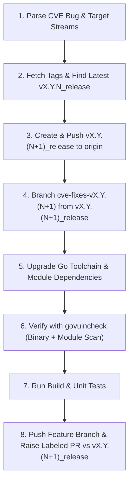

# GCSFuse Release Branch CVE Patching Skill

This skill provides a standardized, end-to-end workflow for remediating security vulnerabilities (CVEs) across one or more GCSFuse release streams (e.g., `v2.11`, `v3.2`, `v3.8`, `v3.11`) as well as `master`. It orchestrates release branch creation, dependency and Go toolchain upgrades, `govulncheck` verification using the target Go toolchain, and Pull Request creation with mandatory CI test labels.

## Related Skills
- **[GCSFuse Minor Release Branch Creation Skill](../minor-release-branch/SKILL.md)**: Cutting a new minor release branch (`v<major>.<minor>.0_release`) from `master` or a specified commit.
- **[GCSFuse Dependency Upgrading Skill](../dep-upgrade/SKILL.md)**: Core rules for querying latest stable module versions, major version upgrade safety checks, Go version file locations, and `go mod tidy` hygiene.
- **[GCSFuse Build and Style Verification Skill](../build/SKILL.md)**: Local compilation, formatting, and static analysis verification via `make build`.
- **[GCSFuse Pull Request Creation Skill](../pull-request/SKILL.md)**: Conventional Commits title/commit alignment, `--draft` mode enforcement, and PR body template formatting.
- **[GCSFuse Integration Testing Skill](../integration-tests/SKILL.md)**: Running and verifying integration tests and triggering presubmit E2E/perf suites.



---

## Phase 1: Triage & Release Stream Discovery

### 1.1 Parse CVE Advisory & Target Streams
From the user prompt or Buganizer issue (e.g., `b/<issue_id>`):
1. Identify all affected release streams (e.g., `v2.11`, `v3.2`, `v3.8`, `v3.11`) or `master`.
2. Identify each vulnerable package or toolchain component and its minimum fixed version:
   - **Go Modules**: e.g., `google.golang.org/grpc >= v1.83.2`, `go.opentelemetry.io/otel/sdk >= v1.45.0`.
   - **Go Toolchain / Standard Library**: e.g., `stdlib` CVEs requiring `Go >= 1.26.9`.

### 1.2 Discover Latest Release Tags and Branches
1. Fetch the latest tags and remote branches from `origin`:
   ```bash
   git fetch origin --tags --prune
   ```
2. For each affected `<major>.<minor>` stream, locate the latest existing release tag `v<major>.<minor>.<N>` and its corresponding release branch `origin/v<major>.<minor>.<N>_release`:
   ```bash
   git tag -l "v<major>.<minor>.*" --sort=-v:refname
   git branch -r --list "origin/v<major>.<minor>.*_release" --sort=-v:refname
   ```

> [!IMPORTANT]
> **Handling Tag/Branch Discrepancies**:
> If a bug report references an older point release (for example, `v3.8.3`), but a newer release tag and branch (such as `v3.8.4` and `origin/v3.8.4_release`) already exist in the repository:
> 1. Inspect `origin/v<major>.<minor>.<latest>_release` (`go.mod` and `.go-version`) to verify whether the vulnerability is still present on the latest release branch.
> 2. Confirm with the user whether to branch from the latest release branch (`v3.8.4_release` -> `v3.8.5_release`) before pushing new release branches.

---

## Phase 2: Release & Feature Branch Creation

For each affected release stream where the latest release is `v<major>.<minor>.<N>`:

1. **Determine the Next Patch Release Name**:
   - Next release version: `v<major>.<minor>.<N+1>`
   - Next release branch: `v<major>.<minor>.<N+1>_release`
   - Feature branch: `cve-fixes-v<major>.<minor>.<N+1>`

2. **Create and Push the New `<next_version>_release` Branch**:
   Create `v<major>.<minor>.<N+1>_release` pointing to the exact commit of `origin/v<major>.<minor>.<N>_release` and push it directly to `origin` so it serves as the clean base branch for the Pull Request:
   ```bash
   git push origin refs/remotes/origin/v<major>.<minor>.<N>_release:refs/heads/v<major>.<minor>.<N+1>_release
   ```

3. **Create the Feature Branch in an Isolated Worktree**:
   Create the feature branch from `v<major>.<minor>.<N+1>_release` inside an isolated `git worktree`:
   ```bash
   WT_DIR=$(mktemp -d /tmp/wt_v<major>_<minor>_<N+1>_XXXXXX)
   git worktree add -b cve-fixes-v<major>.<minor>.<N+1> "${WT_DIR}" origin/v<major>.<minor>.<N+1>_release
   cd "${WT_DIR}"
   ```

> [!IMPORTANT]
> **Mandatory Isolated `git worktree` & `GOWORK=off` Isolation**:
> Always perform release-branch CVE patching, builds, `go mod tidy`, and `govulncheck` verification inside an isolated `git worktree` directory with `GOWORK=off` set on all `go` commands. This prevents parent workspace `go.work` or stale `vendor/` directories (`go: inconsistent vendoring`) and branch-switching interference from corrupting verification. Always remove temporary worktrees (`git worktree remove "${WT_DIR}"`) before finishing.

---

## Phase 3: Dependency & Toolchain Upgrades

Follow all version selection and safety rules in the [GCSFuse Dependency Upgrading Skill](../dep-upgrade/SKILL.md):
- **Latest Patch/Minor Target**: Upgrade affected module dependencies to their **latest stable minor/patch version** unless the user specifies otherwise.
- **Go Toolchain Upgrade Requires User Confirmation**: Whenever a Go compiler/stdlib upgrade is indicated (by the CVE advisory, `govulncheck`, or module `go` directive requirements), **ask the user for confirmation first** before upgrading the Golang version, stating the current Go version on the branch and the proposed target Go version (e.g., `1.26.9`).
- **No Unapproved Major Bumps or Downgrades**: Stop and ask the user for approval if an upgrade crosses a major version boundary or would downgrade an existing version in `go.mod`.

### 3.1 Go Toolchain Upgrades on Release Branches (After User Confirmation)
Once the user confirms the Go version upgrade (e.g., to `1.26.9`), ensure **strict three-part version consistency** across every file in the target release branch that pins the Go version:
1. `[.go-version](../../../.go-version)`
2. `[go.mod](../../../go.mod)` (must use the full patch version, e.g., `go 1.26.9`, never `go 1.26`)
3. `[Dockerfile](../../../Dockerfile)`, `[tools/containerize_gcsfuse_docker/Dockerfile](../../../tools/containerize_gcsfuse_docker/Dockerfile)`, and `[tools/package_gcsfuse_docker/Dockerfile](../../../tools/package_gcsfuse_docker/Dockerfile)`
4. E2E and perf scripts under `tools/cd_scripts/`, `tools/integration_tests/`, and `perfmetrics/scripts/` (including `perfmetrics/scripts/testing_on_gke/examples/run-gke-tests.sh`, `perfmetrics/scripts/ml_tests/pytorch/run_model.sh`, and `perfmetrics/scripts/ml_tests/tf/resnet/setup_scripts/setup_container.sh` where present)
5. **Release Branch CI Workflows (`.github/workflows/*.yml`)**:
   - Older release branches frequently hardcode `go-version:` inside `.github/workflows/*.yml`.
   - Search the branch for both the previous `.go-version` string and `go-version:` across the entire repository to ensure no stale Go version strings remain.

### 3.2 Module Dependency Upgrades
1. Check current versions in `go.mod`. If a target dependency is already at or above the fixed latest version on a given branch, do not downgrade it.
2. Upgrade affected modules (and aligned peer modules such as `go.opentelemetry.io/otel/*` when upgrading `otel/sdk`):
   ```bash
   TARGET_GO=$(tr -d '[:space:]' < .go-version)
   GOWORK=off GOTOOLCHAIN=go${TARGET_GO} go get <module_path>@<target_version>
   GOWORK=off GOTOOLCHAIN=go${TARGET_GO} go mod tidy
   ```

---

## Phase 4: Comprehensive `govulncheck` Verification

Always run `govulncheck` in an isolated worktree across every patched branch to ensure that:
1. All reported CVEs from the issue are resolved.
2. Zero `Symbol`, `Package`, or fixable `Module` (tagged `Fixed in: <mod>@vX.Y.Z`) vulnerabilities remain in the compiled `gcsfuse` binary.

### 4.1 Target-Toolchain Binary Scan (`-mode=binary -show verbose`) & Exit-Code Preservation
Running `govulncheck ./...` in source mode uses the **host environment's default `go` binary** (for example, `go1.27.0`), which can fail on parent `go.work`/`vendor/` directories or misreport `stdlib` vulnerabilities for the host's Go version rather than the toolchain declared in `.go-version`. Furthermore, running `govulncheck -mode=binary` without `-show verbose` hides `=== Module Results ===` (which GKE `IMAGE_SCANNING` / Scarab still flags via `go version -m` buildinfo).

To accurately verify the branch in an isolated worktree with its target Go toolchain:
1. **Ensure `govulncheck` is installed and prepended to `PATH`, build the binary in a per-run `mktemp -d` directory with `GOWORK=off` and `.go-version`, and run `govulncheck -mode=binary -show verbose`**:
   ```bash
   if ! command -v govulncheck &> /dev/null; then
     go install golang.org/x/vuln/cmd/govulncheck@latest
     export PATH=$(go env GOPATH)/bin:$PATH
   fi
   TMP_DIR=$(mktemp -d)
   TARGET_GO=$(tr -d '[:space:]' < .go-version)
   GOWORK=off GOTOOLCHAIN=go${TARGET_GO} go build -o "${TMP_DIR}/gcsfuse-vulncheck" .
   govulncheck -mode=binary -show verbose "${TMP_DIR}/gcsfuse-vulncheck"
   ```
   > [!CAUTION]
   > **Strict Exit-Code Preservation**:
   > **NEVER** append `; rm -rf "${TMP_DIR}"` on the same command line after `govulncheck` without `set -e`, because `rm` overwrites `govulncheck`'s non-zero exit code (`3`) with `0`. Always run `govulncheck` as the final command in the step (or under `set -e`) so any non-zero exit code fails visibly.
2. **Inspect both exit status and `-show verbose` output sections**:
   - Verify `=== Symbol Results ===` reports `No vulnerabilities found.` (and exit code is `0`).
   - Verify `=== Package Results ===` reports `No other vulnerabilities found.` / `No vulnerabilities found.`
   - Inspect `=== Module Results ===` and verify **no** module advisories have a published tagged release fix (`Fixed in: <mod>@vX.Y.Z` without a `-0.<timestamp>-<commit>` pseudo-version suffix).
3. **Remove the temporary directory in a separate step after verification passes**:
   ```bash
   rm -rf "${TMP_DIR}"
   ```

### 4.2 Checking for Additional Transitive Module Advisories
Inspect the `=== Module Results ===` output from `govulncheck -mode=binary -show verbose "${TMP_DIR}/gcsfuse-vulncheck"`:
- **Fixable Module-Level CVEs with Tagged Releases (`Fixed in: <mod>@vX.Y.Z`)**:
  Even when `=== Symbol Results ===` is `0` (so `govulncheck` exits with `0`), any module-level advisory whose `Fixed in:` specifies a **tagged release version** (`@vX.Y.Z`, e.g., `golang.org/x/net@v0.62.0`) is embedded in the binary's Go module table and will trigger container vulnerability scanners. Upgrade those packages to their latest tagged stable versions (`GOWORK=off GOTOOLCHAIN=go${TARGET_GO} go get <pkg>@latest && GOWORK=off GOTOOLCHAIN=go${TARGET_GO} go mod tidy`), rebuild `"${TMP_DIR}/gcsfuse-vulncheck"`, and re-verify with `govulncheck -mode=binary -show verbose "${TMP_DIR}/gcsfuse-vulncheck"`.
- **Unfixed or Untagged Pseudo-Version Indirect Module Notices (`Fixed in: N/A` or `@vX.Y.Z-0.<timestamp>-<commit>`)**:
  If `govulncheck -mode=binary -show verbose` reports module-only notices with `Fixed in: N/A` **or an untagged pseudo-version** (`Fixed in: <mod>@vX.Y.Z-0.<timestamp>-<commit>` where no newer tagged release exists in `GOWORK=off go list -m -versions <mod>`, such as `GO-2026-5932` in deprecated `golang.org/x/crypto/openpgp` or `github.com/aws/aws-sdk-go` in older release streams), **do NOT pin untagged pseudo-versions**. Instead, confirm via `GOWORK=off go list -deps ./... | grep <pkg>` that `gcsfuse` does not import the vulnerable subpackage and document this non-blocking notice in the summary for the user.

### 4.3 Gate Action: Zero Fixable Vulnerabilities Required Before PR Creation
> [!IMPORTANT]
> **Mandatory Blocking Pre-PR Gate**:
> Even if the user prompt or Buganizer issue names only a single library or CVE, the agent **MUST NOT** create a Pull Request if `govulncheck -mode=binary -show verbose "${TMP_DIR}/gcsfuse-vulncheck"` reports **any** remaining `Symbol`, `Package`, or fixable tagged `Module` (`Fixed in: <mod>@vX.Y.Z`) findings.
> - If any fixable tagged module vulnerabilities (`Fixed in: <mod>@vX.Y.Z`) remain, upgrade those modules (`GOWORK=off GOTOOLCHAIN=go${TARGET_GO} go get <pkg>@<version> && GOWORK=off GOTOOLCHAIN=go${TARGET_GO} go mod tidy`) and re-run the binary scan until `0` fixable vulnerabilities remain.
> - If a Go `stdlib` / toolchain vulnerability (`Fixed in: <pkg>@goX.Y.Z`) or major module version upgrade is required to clear all findings and has not yet been confirmed by the user, **stop before creating any PR** and ask the user for confirmation to include the Go toolchain / major upgrade so the branch achieves zero fixable vulnerabilities.
> - **Prohibition on Partial PR Claims**: Never raise a PR or write a PR testing summary claiming partial verification such as `(0 vulnerabilities in <single-package>)` or `(0 vulnerabilities in imported packages)` when other `Symbol`, `Package`, or fixable tagged `Module` vulnerabilities remain in the binary.

---

## Phase 5: Build, Unit Test & Integration Test Verification

On each feature branch, follow the [GCSFuse Build and Style Verification Skill](../build/SKILL.md) and [GCSFuse Integration Testing Skill](../integration-tests/SKILL.md):
1. Verify clean compilation, formatting, and module tidiness (`make build`):
   ```bash
   TARGET_GO=$(tr -d '[:space:]' < .go-version)
   GOWORK=off GOTOOLCHAIN=go${TARGET_GO} make build
   GOWORK=off GOTOOLCHAIN=go${TARGET_GO} go mod tidy
   GOWORK=off GOTOOLCHAIN=go${TARGET_GO} go build ./...
   ```
2. Run unit tests for core packages:
   ```bash
   GOWORK=off GOTOOLCHAIN=go${TARGET_GO} go test ./cmd/... ./internal/...
   ```
3. Follow [GCSFuse Integration Testing Skill](../integration-tests/SKILL.md) safety rules (**never** run `./tools/integration_tests/...` locally on Cloudtop; trigger presubmit E2E and performance suites via the `execute-integration-tests` and `execute-perf-test` PR labels in Phase 6, or run manually only on a dedicated GCE VM).
4. Confirm the working tree has no untracked files or unstaged diffs (`git status --porcelain`).

---

## Phase 6: Pull Request Creation & Labeling

Follow all formatting, commit alignment, and `--draft` mode rules in the [GCSFuse Pull Request Creation Skill](../pull-request/SKILL.md):

1. **Commit and Push the Feature Branch**:
   Format the commit message using Conventional Commits (`fix(deps): ...` or `build(deps): ...`) matching the PR title and push to `origin`:
   ```bash
   git push -u origin cve-fixes-v<major>.<minor>.<N+1>
   ```

2. **Prepare the PR Description**:
   Follow the [GCSFuse Pull Request Creation Skill](../pull-request/SKILL.md) template (starting directly with `### Description`, omitting the top instructional comment block):
   ```markdown
   ### Description
   Upgrade Go toolchain to `<go_version>` and `<module>` to `<version>` on `v<major>.<minor>.<N+1>_release` to remediate <CVE_LIST>.

   ### Link to the issue in case of a bug fix.
   Fixes b/<issue_id>

   ### Testing details
   1. Manual - Verified `make build`, `go build ./...`, `go mod tidy`, and `govulncheck -mode=binary -show verbose` (0 Symbol, Package, and fixable Module vulnerabilities with `go<go_version>`)
   2. Unit tests - Passed (`go test ./cmd/... ./internal/...`)
   3. Integration tests - Triggered via `execute-integration-tests` and `execute-perf-test` PR labels

   ### Any backward incompatible change? If so, please explain.
   N/A
   ```
   > [!IMPORTANT]
   > Do **not** use partial verification claims such as `(0 vulnerabilities in <single-package>)` when other `Symbol`, `Package`, or fixable `Module` (`Fixed in: vX.Y.Z`) vulnerabilities remain. A PR may only be created once all fixable vulnerabilities in the binary are resolved.

3. **Raise the PR in Draft Mode (`--draft`) Targeting `v<major>.<minor>.<N+1>_release` with Mandatory Labels**:
   Every release-branch CVE PR must be created in **Draft** mode (`--draft` per [GCSFuse Pull Request Creation Skill](../pull-request/SKILL.md)), target `v<major>.<minor>.<N+1>_release`, and be tagged with **`execute-integration-tests`** and **`execute-perf-test`**:
   ```bash
   gh pr create \
     --repo GoogleCloudPlatform/gcsfuse \
     --base v<major>.<minor>.<N+1>_release \
     --head cve-fixes-v<major>.<minor>.<N+1> \
     --title "fix(deps): upgrade <summary> for CVE remediation" \
     --body-file <pr_body_file> \
     --draft \
     --label "execute-integration-tests" \
     --label "execute-perf-test"
   ```

> [!NOTE]
> **Workaround for `gh pr edit` GraphQL `projectCards` Deprecation Error**:
> Older versions of the `gh` CLI may fail when running `gh pr edit` with:
> `GraphQL: Projects (classic) is being deprecated in favor of the new Projects experience... (repository.pullRequest.projectCards)`
> If this occurs when updating a PR title, body, or labels, use `gh api` over REST instead:
> ```bash
> # Update PR title and body:
> gh api -X PATCH repos/GoogleCloudPlatform/gcsfuse/pulls/<PR_NUMBER> \
>   -f title="<new_title>" \
>   -F body=@<pr_body_file>
>
> # Add labels to a PR:
> gh api -X POST repos/GoogleCloudPlatform/gcsfuse/issues/<PR_NUMBER>/labels \
>   -f "labels[]=execute-integration-tests" \
>   -f "labels[]=execute-perf-test"
> ```

---

## Verification Checklist

Before completing the task, verify the following for every target release stream:
- [ ] `origin/v<major>.<minor>.<N+1>_release` exists on `origin` and points to the exact commit of `origin/v<major>.<minor>.<N>_release`.
- [ ] `.go-version`, `go.mod`, Dockerfiles, build/test scripts, and `.github/workflows/*.yml` all use the exact same three-part Go version string.
- [ ] All upgraded modules are at their latest stable minor/patch versions (with no unapproved major version bumps or downgrades).
- [ ] `GOWORK=off GOTOOLCHAIN=go${TARGET_GO} go build -o "${TMP_DIR}/gcsfuse-vulncheck" .` and `govulncheck -mode=binary -show verbose "${TMP_DIR}/gcsfuse-vulncheck"` (run in an isolated worktree without trailing `; rm -rf`) report `0` `Symbol`, `Package`, and fixable tagged `Module` (`Fixed in: <mod>@vX.Y.Z`) vulnerabilities before any PR is created.
- [ ] `go mod tidy` produces zero diffs and `go build ./...` + unit tests pass.
- [ ] Each GitHub PR is `OPEN` in **Draft** mode (`--draft`), targets `v<major>.<minor>.<N+1>_release`, and has both `execute-integration-tests` and `execute-perf-test` labels applied.
