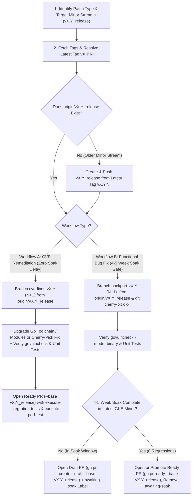

# GCSFuse Release Branch CVE Patching & Backport Skill

This skill provides a standardized, end-to-end workflow for landing patch releases (`v<major>.<minor>.<N+1>`) onto persistent GCSFuse minor release branches (`v<major>.<minor>_release`, e.g., `v2.11_release`, `v3.2_release`, `v3.5_release`, `v3.8_release`, `v3.11_release`, `v3.12_release`) as well as `master`.

All patch releases for a `<major>.<minor>` series land directly on the single persistent minor release branch **`v<major>.<minor>_release`**. This skill covers both release-branch backport workflows defined by the GCSFuse release branching strategy:
- **Workflow A: CVE Remediation (Zero Soak Delay — Multi-Branch Fan-Out)**: Exempt from soak requirements; applied, verified, merged, and released immediately across all active `v<major>.<minor>_release` branches in parallel.
- **Workflow B: Functional Bug Fix Backport (Soak-Gated Merge Rule — 4–5 Week Soak)**: Must complete a mandatory **4–5 week soak** in the latest GKE minor release before being merged into any locked `v<major>.<minor>_release` branch (may be staged early as a Draft PR with the `awaiting-soak` label).

## Related Skills
- **[GCSFuse Minor Release Branch Creation Skill](../minor-release-branch/SKILL.md)**: Cutting a new persistent minor release branch (`v<major>.<minor>_release`) from `master` or a specified commit.
- **[GCSFuse Dependency Upgrading Skill](../dep-upgrade/SKILL.md)**: Core rules for querying latest stable module versions, major version upgrade safety checks, Go version file locations, and `go mod tidy` hygiene.
- **[GCSFuse Pull Request Creation Skill](../pull-request/SKILL.md)**: Conventional Commits title standards and PR body template formatting.
- **[GCSFuse Build and Style Verification Skill](../build/SKILL.md)**: Local compilation and formatting verification checks.



---

## Workflow A: CVE Remediation (Zero Soak Delay — Multi-Branch Fan-Out)

CVE remediations are **exempt from soak requirements**. Because persistent `v<major>.<minor>_release` branches are kept free of un-soaked functional changes, security fixes can be applied, verified, merged, and released immediately across all active `v<major>.<minor>_release` minor branches in parallel.
> [!NOTE]
> **EOL Policy**: A `v<major>.<minor>_release` branch reaches End of Life (EOL) 2 years after the release of the last GKE minor version that depends on it. Only patch active (non-EOL) release streams.

### Phase A1: Triage & Release Stream Discovery

#### A1.1 Parse CVE Advisory & Target Streams
From the user prompt or security advisory / issue tracker ticket:
1. Identify all affected release streams (e.g., `v2.11`, `v3.2`, `v3.5`, `v3.8`, `v3.11`, `v3.12`) or `master`.
2. Identify each vulnerable package or toolchain component and its minimum fixed version:
   - **Go Modules**: e.g., `google.golang.org/grpc >= v1.83.2`, `go.opentelemetry.io/otel/sdk >= v1.45.0`.
   - **Go Toolchain / Standard Library**: e.g., `stdlib` CVEs requiring `Go >= 1.26.9`.

#### A1.2 Discover Latest Release Tags and Persistent Minor Release Branches
1. Fetch the latest tags and remote branches from `origin`:
   ```bash
   git fetch origin --tags --prune
   ```
2. For each affected `<major>.<minor>` stream, locate the latest existing release tag `v<major>.<minor>.<N>` (so the next patch version is `v<major>.<minor>.<N+1>`) and check for the persistent release branch `origin/v<major>.<minor>_release`:
   ```bash
   git tag -l "v<major>.<minor>.*" --sort=-v:refname
   git branch -r --list "origin/v<major>.<minor>_release" --sort=-v:refname
   ```

> [!IMPORTANT]
> **Handling Tag/Branch Discrepancies**:
> If a vulnerability report references an older point release (for example, `v3.8.3`), but a newer release tag `v3.8.4` already exists in the repository:
> 1. Inspect `origin/v<major>.<minor>_release` (or tag `v<major>.<minor>.<N>` if `origin/v<major>.<minor>_release` has not been created yet) to check `go.mod` and `.go-version` and verify whether the vulnerability is still present on the latest release state.
> 2. Confirm that `origin/v<major>.<minor>_release` HEAD matches `refs/tags/v<major>.<minor>.<N>` (or contains expected post-tag commits).

---

### Phase A2: Persistent Release Branch Verification, Tag Bootstrapping & Feature Branch Creation

For each affected `<major>.<minor>` release stream where the latest release tag is `v<major>.<minor>.<N>`:

1. **Determine Target Names**:
   - Next patch release version: `v<major>.<minor>.<N+1>`
   - Persistent target base branch: `v<major>.<minor>_release`
   - Feature branch: `cve-fixes-v<major>.<minor>.<N+1>`

2. **Verify `origin/v<major>.<minor>_release` or Bootstrap from Latest Release Tag `v<major>.<minor>.<N>`**:
   - **Case 1 (`origin/v<major>.<minor>_release` exists on `origin`)**:
     Verify that `origin/v<major>.<minor>_release` points to `refs/tags/v<major>.<minor>.<N>` (or is a descendant containing expected commits):
     ```bash
     git rev-parse origin/v<major>.<minor>_release
     git rev-parse refs/tags/v<major>.<minor>.<N>^{commit}
     ```
   - **Case 2 (Bootstrap `v<major>.<minor>_release` for an Older Minor Stream)**:
     If `origin/v<major>.<minor>_release` does **not** exist yet on `origin`, create the persistent `v<major>.<minor>_release` branch directly from the latest release tag `v<major>.<minor>.<N>` and push it to `origin`:
     ```bash
     git checkout -b v<major>.<minor>_release v<major>.<minor>.<N>
     git push -u origin v<major>.<minor>_release
     ```
     > [!IMPORTANT]
     > All PRs for the `<major>.<minor>` series must target `v<major>.<minor>_release`.

3. **Create the Feature Branch**:
   Create the feature branch `cve-fixes-v<major>.<minor>.<N+1>` from `origin/v<major>.<minor>_release`:
   ```bash
   git checkout -b cve-fixes-v<major>.<minor>.<N+1> origin/v<major>.<minor>_release
   ```

> [!TIP]
> **Parallelizing Across Multiple Release Streams**:
> When patching multiple release streams simultaneously, use isolated `git worktree` directories (e.g., `git worktree add -b cve-fixes-v2.11.7 <worktree_path> origin/v2.11_release`) so builds, `go mod tidy`, and unit tests can run concurrently without branch-switching interference. Always remove temporary worktrees (`git worktree remove <worktree_path>`) before finishing.

---

### Phase A3: Dependency & Toolchain Upgrades (or CVE Commit Cherry-Pick)

Follow all version selection and safety rules in the [GCSFuse Dependency Upgrading Skill](../dep-upgrade/SKILL.md):
- **Latest Patch/Minor Target**: Upgrade affected module dependencies to their **latest stable minor/patch version** unless the user specifies otherwise (or `git cherry-pick -x <commit_sha>` if backporting a CVE fix commit from `master`).
- **Go Toolchain Upgrade Requires User Confirmation**: Whenever a Go compiler/stdlib upgrade is indicated (by the CVE advisory, `govulncheck`, or module `go` directive requirements), **ask the user for confirmation first** before upgrading the Golang version, stating the current Go version on the branch and the proposed target Go version (e.g., `1.26.9`).
- **No Unapproved Major Bumps or Downgrades**: Stop and ask the user for approval if an upgrade crosses a major version boundary or would downgrade an existing version in `go.mod`.

#### A3.1 Go Toolchain Upgrades on Release Branches (After User Confirmation)
Once the user confirms the Go version upgrade (e.g., to `1.26.9`), ensure **strict three-part version consistency** across every file in the target release branch that pins the Go version:
1. `[.go-version](../../../.go-version)`
2. `[go.mod](../../../go.mod)` (must use the full patch version, e.g., `go 1.26.9`, never `go 1.26`)
3. `[Dockerfile](../../../Dockerfile)`, `[tools/containerize_gcsfuse_docker/Dockerfile](../../../tools/containerize_gcsfuse_docker/Dockerfile)`, and `[tools/package_gcsfuse_docker/Dockerfile](../../../tools/package_gcsfuse_docker/Dockerfile)`
4. E2E and perf scripts under `tools/cd_scripts/`, `tools/integration_tests/`, and `perfmetrics/scripts/`
5. **Release Branch CI Workflows (`.github/workflows/*.yml`)**:
   - Older release branches frequently hardcode `go-version:` inside `.github/workflows/*.yml`.
   - Search the branch for both the previous `.go-version` string and `go-version:` across `.github/` and `tools/` to ensure no stale Go version strings remain.

#### A3.2 Module Dependency Upgrades
1. Check current versions in `go.mod`. If a target dependency is already at or above the fixed latest version on a given branch, do not downgrade it.
2. Upgrade affected modules (and aligned peer modules such as `go.opentelemetry.io/otel/*` when upgrading `otel/sdk`):
   ```bash
   go get <module_path>@<target_version>
   go mod tidy
   ```

---

### Phase A4: Comprehensive `govulncheck` Verification

Always run `govulncheck` across every patched branch to ensure that:
1. All reported CVEs from the advisory are resolved.
2. No additional reachable CVEs or fixable transitive module vulnerabilities (such as in `golang.org/x/net` or `golang.org/x/crypto`) are left behind.

#### A4.1 Avoiding Host Go Toolchain False Positives (`-mode=binary`)
Running `govulncheck ./...` in source mode uses the **host environment's default `go` binary** (for example, `go1.27.0`), which can flag `stdlib` vulnerabilities for the host's Go version rather than the `go 1.26.x` toolchain declared in the branch's `go.mod`.

To accurately verify the branch with its target Go toolchain:
1. **Compile the `gcsfuse` binary using the exact target Go version** from `.go-version` (via `GOTOOLCHAIN=go<version>` or the cached module toolchain binary under `$(go env GOPATH)/pkg/mod/golang.org/toolchain@v0.0.1-go<version>.linux-amd64/bin/go`):
   ```bash
   GOTOOLCHAIN=go<target_go_version> go build -o /tmp/gcsfuse-vulncheck .
   ```
2. **Run `govulncheck` in binary mode**:
   ```bash
   govulncheck -mode=binary /tmp/gcsfuse-vulncheck
   ```
   Verify that it exits with code `0` and outputs `No vulnerabilities found.`
3. **Remove the temporary binary**:
   ```bash
   rm -f /tmp/gcsfuse-vulncheck
   ```

#### A4.2 Checking for Additional Transitive Module Advisories
Also inspect `govulncheck ./...` output for any non-stdlib module advisories:
- **Fixable Reachable or Module-Level CVEs (`Fixed in: vX.Y.Z`)**:
   If `govulncheck` reports additional vulnerabilities in direct or transitive dependencies that have a published fix (e.g., `golang.org/x/net` or `golang.org/x/crypto`), upgrade those packages to their latest patched versions (`go get <pkg>@latest && go mod tidy`) and re-verify.
- **Unfixed / Deprecated Indirect Module Notices (`Fixed in: N/A`)**:
   If `govulncheck` reports informational module-only notices with `Fixed in: N/A` for packages that are not imported by `gcsfuse` (for example, deprecated `golang.org/x/crypto/openpgp` or `github.com/aws/aws-sdk-go` in older release streams), confirm via `go list -deps ./... | grep <pkg>` that `gcsfuse` does not import the vulnerable package and document this in the summary for the user.

---

### Phase A5: Build & Unit Test Verification

On each feature branch:
1. Verify clean compilation and module tidiness:
   ```bash
   go mod tidy
   go build ./...
   ```
2. Run unit tests for core packages:
   ```bash
   go test ./cmd/... ./internal/...
   ```
3. Confirm the working tree has no untracked files or unstaged diffs (`git status --porcelain`).

---

### Phase A6: Pull Request Creation & Labeling (`--base v<major>.<minor>_release`)

1. **Commit and Push the Feature Branch**:
   Format the commit message using Conventional Commits (`fix(deps): ...` or `build(deps): ...`) and push to `origin`:
   ```bash
   git push -u origin cve-fixes-v<major>.<minor>.<N+1>
   ```

2. **Prepare the PR Description**:
   Follow the [GCSFuse Pull Request Creation Skill](../pull-request/SKILL.md) template (starting directly with `### Description`, omitting the top instructional comment block):
   ```markdown
   ### Description
   Upgrade Go toolchain to `<go_version>` and `<module>` to `<version>` on `v<major>.<minor>_release` (for `v<major>.<minor>.<N+1>`) to remediate <CVE_LIST>.

   ### Link to the issue in case of a bug fix.
   <issue_id_or_url>

   ### Testing details
   1. Manual - Verified `go build ./...`, `go mod tidy`, and `govulncheck -mode=binary` (0 affected vulnerabilities with `go<go_version>`)
   2. Unit tests - Passed (`go test ./cmd/... ./internal/...`)
   3. Integration tests - Triggered via PR label

   ### Any backward incompatible change? If so, please explain.
   N/A
   ```

3. **Raise the PR Targeting `v<major>.<minor>_release` with Mandatory Labels**:
   Every release-branch CVE PR must target `v<major>.<minor>_release` and be tagged with **`execute-integration-tests`** and **`execute-perf-test`**:
   ```bash
   gh pr create \
     --repo GoogleCloudPlatform/gcsfuse \
     --base v<major>.<minor>_release \
     --head cve-fixes-v<major>.<minor>.<N+1> \
     --title "fix(deps): upgrade <summary> for CVE remediation (v<major>.<minor>.<N+1>)" \
     --body-file <pr_body_file> \
     --label "execute-integration-tests" \
     --label "execute-perf-test"
   ```

---

## Workflow B: Functional Bug Fix Backport (Soak-Gated Merge Rule — 4–5 Week Soak)

> [!WARNING]
> **Mandatory 4–5 Week Soak Gate for Functional Bug Fixes**:
> Functional bug fixes must **never** be merged into a locked `v<major>.<minor>_release` branch until they have completed a mandatory **4–5 week soak** in the GCSFuse release stream tracking the latest GKE minor release with zero regressions. Only backport critical fixes explicitly required on an older GKE minor version.

### Step 1: Verify `master` Merge & 4–5 Week Soak Status
1. Verify that the functional bug fix commit `<commit_sha>` is already merged into `origin/master`:
   ```bash
   git fetch origin --tags --prune
   git merge-base --is-ancestor <commit_sha> origin/master
   git show -s --format="Commit: %H%nCommitDate: %ci%nTitle: %s" <commit_sha>
   ```
2. Determine whether the fix has completed its **4–5 week soak** in the GCSFuse release stream tracking the latest GKE minor version (recording the soak start date and the earliest eligible merge date, 4–5 weeks after landing in the latest GKE minor stream).

### Step 2: Branch from `origin/v<major>.<minor>_release`, Cherry-Pick, and Verify
1. Find the latest release tag `v<major>.<minor>.<N>` on the target `<major>.<minor>` stream (so the upcoming patch release is `v<major>.<minor>.<N+1>`).
2. Verify that `origin/v<major>.<minor>_release` exists on `origin` (if `origin/v<major>.<minor>_release` does not yet exist for an older minor stream, create it directly from the latest release tag `v<major>.<minor>.<N>` via `git checkout -b v<major>.<minor>_release v<major>.<minor>.<N>` and `git push -u origin v<major>.<minor>_release`).
3. Check out feature branch `backport-v<major>.<minor>.<N+1>-<short-slug>` from `origin/v<major>.<minor>_release` and cherry-pick the commit with `-x`:
   ```bash
   git checkout -b backport-v<major>.<minor>.<N+1>-<short-slug> origin/v<major>.<minor>_release
   git cherry-pick -x <commit_sha>
   ```
4. Run target-toolchain `govulncheck -mode=binary` (per Phase A4.1) and unit tests to verify the cherry-pick introduces zero vulnerabilities and zero test regressions:
   ```bash
   TARGET_GO=$(tr -d '[:space:]' < .go-version)
   GOTOOLCHAIN=go${TARGET_GO} go build -o /tmp/gcsfuse-vulncheck .
   govulncheck -mode=binary /tmp/gcsfuse-vulncheck
   rm -f /tmp/gcsfuse-vulncheck
   go test ./cmd/... ./internal/...
   ```

### Step 3: Soak Gate Enforcement on PR Creation

Push the feature branch to `origin`:
```bash
git push -u origin backport-v<major>.<minor>.<N+1>-<short-slug>
```

Then enforce the soak gate based on whether the 4–5 week soak window has completed:

- **Case 3a: 4–5 Week Soak Is NOT Yet Complete (Stage as Draft PR with `awaiting-soak`)**:
  To avoid losing context during the soak window, open a **Draft PR (`gh pr create --draft`)** targeting `--base v<major>.<minor>_release` with labels **`awaiting-soak`**, **`execute-integration-tests`**, and **`execute-perf-test`**. Document the soak start date and earliest eligible merge date in the PR description. **Do NOT mark ready or merge until the 4–5 week soak completes.**
  ```bash
  gh pr create \
    --draft \
    --repo GoogleCloudPlatform/gcsfuse \
    --base v<major>.<minor>_release \
    --head backport-v<major>.<minor>.<N+1>-<short-slug> \
    --title "fix(<scope>): backport <summary> (v<major>.<minor>.<N+1>)" \
    --body-file <pr_body_file> \
    --label "awaiting-soak" \
    --label "execute-integration-tests" \
    --label "execute-perf-test"
  ```
  *(Include `**Soak Status**: Awaiting 4–5 week soak (Soak Start: YYYY-MM-DD, Earliest Eligible Merge Date: YYYY-MM-DD)` in the `### Description` section of `<pr_body_file>`.)*

- **Case 3b: 4–5 Week Soak IS Complete with Zero Regressions (Open or Promote Ready PR)**:
  - If opening a new PR after the 4–5 week soak has completed:
    ```bash
    gh pr create \
      --repo GoogleCloudPlatform/gcsfuse \
      --base v<major>.<minor>_release \
      --head backport-v<major>.<minor>.<N+1>-<short-slug> \
      --title "fix(<scope>): backport <summary> (v<major>.<minor>.<N+1>)" \
      --body-file <pr_body_file> \
      --label "execute-integration-tests" \
      --label "execute-perf-test"
    ```
  - If promoting an existing staged Draft PR once the 4–5 week soak completes:
    ```bash
    gh pr ready <PR_NUMBER> --repo GoogleCloudPlatform/gcsfuse
    gh api -X DELETE repos/GoogleCloudPlatform/gcsfuse/issues/<PR_NUMBER>/labels/awaiting-soak
    ```

> [!NOTE]
> **Workaround for `gh pr edit` GraphQL `projectCards` Deprecation Error**:
> Older versions of the `gh` CLI may fail when running `gh pr edit` with:
> `GraphQL: Projects (classic) is being deprecated in favor of the new Projects experience... (repository.pullRequest.projectCards)`
> If this occurs when updating a PR title, body, or labels, use `gh api` over REST instead:
> ```bash
> # Update PR title and body:
> gh api -X PATCH repos/GoogleCloudPlatform/gcsfuse/pulls/<PR_NUMBER> \
>   -f title="<new_title>" \
>   -F body=@<pr_body_file>
>
> # Add labels to a PR:
> gh api -X POST repos/GoogleCloudPlatform/gcsfuse/issues/<PR_NUMBER>/labels \
>   -f "labels[]=execute-integration-tests" \
>   -f "labels[]=execute-perf-test"
> ```

---

## Verification Checklist

Before completing the task, verify the following for every target release stream:
- [ ] Persistent `origin/v<major>.<minor>_release` exists on `origin` (created directly from the latest release tag `v<major>.<minor>.<N>` if `origin/v<major>.<minor>_release` did not yet exist).
- [ ] Feature branch (`cve-fixes-v<major>.<minor>.<N+1>` for Workflow A, or `backport-v<major>.<minor>.<N+1>-<short-slug>` for Workflow B) was branched cleanly from `origin/v<major>.<minor>_release`.
- [ ] For Go toolchain upgrades (Workflow A): `.go-version`, `go.mod`, Dockerfiles, build/test scripts, and `.github/workflows/*.yml` all use the exact same three-part Go version string, and all upgraded modules are at their latest stable minor/patch versions (with no unapproved major version bumps or downgrades).
- [ ] `govulncheck -mode=binary` built with the branch's target Go toolchain reports `0` vulnerabilities, and all fixable transitive module advisories have been patched.
- [ ] `go mod tidy` produces zero diffs and `go build ./...` + unit tests pass.
- [ ] Each GitHub PR targets `--base v<major>.<minor>_release` and has `execute-integration-tests` and `execute-perf-test` labels applied.
- [ ] For Workflow B (Functional Bug Fix Backports): if the 4–5 week soak is not yet complete, the PR is in **Draft** state (`--draft`) with the `awaiting-soak` label and soak dates documented; if the 4–5 week soak is complete, the PR is ready for review without `awaiting-soak`.
