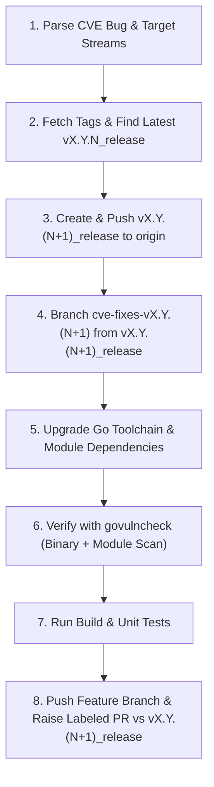

# GCSFuse Release Branch CVE Patching Skill

This skill provides a standardized, end-to-end workflow for remediating security vulnerabilities (CVEs) across one or more GCSFuse release streams (e.g., `v2.11`, `v3.2`, `v3.8`, `v3.11`) as well as `master`. It orchestrates release branch creation, dependency and Go toolchain upgrades, `govulncheck` verification using the target Go toolchain, and Pull Request creation with mandatory CI test labels.

## Related Skills
- **[GCSFuse Dependency Upgrading Skill](../dep-upgrade/SKILL.md)**: Core rules for querying latest stable module versions, major version upgrade safety checks, Go version file locations, and `go mod tidy` hygiene.
- **[GCSFuse Pull Request Creation Skill](../pull-request/SKILL.md)**: Conventional Commits title standards and PR body template formatting.
- **[GCSFuse Build and Style Verification Skill](../build/SKILL.md)**: Local compilation and formatting verification checks.



---

## Phase 1: Triage & Release Stream Discovery

### 1.1 Parse CVE Advisory & Target Streams
From the user prompt or Buganizer issue (e.g., `b/<issue_id>`):
1. Identify all affected release streams (e.g., `v2.11`, `v3.2`, `v3.8`, `v3.11`) or `master`.
2. Identify each vulnerable package or toolchain component and its minimum fixed version:
   - **Go Modules**: e.g., `google.golang.org/grpc >= v1.83.2`, `go.opentelemetry.io/otel/sdk >= v1.45.0`.
   - **Go Toolchain / Standard Library**: e.g., `stdlib` CVEs requiring `Go >= 1.26.9`.

### 1.2 Discover Latest Release Tags and Branches
1. Fetch the latest tags and remote branches from `origin`:
   ```bash
   git fetch origin --tags --prune
   ```
2. For each affected `<major>.<minor>` stream, locate the latest existing release tag `v<major>.<minor>.<N>` and its corresponding release branch `origin/v<major>.<minor>.<N>_release`:
   ```bash
   git tag -l "v<major>.<minor>.*" --sort=-v:refname
   git branch -r --list "origin/v<major>.<minor>.*_release" --sort=-v:refname
   ```

> [!IMPORTANT]
> **Handling Tag/Branch Discrepancies**:
> If a bug report references an older point release (for example, `v3.8.3`), but a newer release tag and branch (such as `v3.8.4` and `origin/v3.8.4_release`) already exist in the repository:
> 1. Inspect `origin/v<major>.<minor>.<latest>_release` (`go.mod` and `.go-version`) to verify whether the vulnerability is still present on the latest release branch.
> 2. Confirm with the user whether to branch from the latest release branch (`v3.8.4_release` -> `v3.8.5_release`) before pushing new release branches.

---

## Phase 2: Release & Feature Branch Creation

For each affected release stream where the latest release is `v<major>.<minor>.<N>`:

1. **Determine the Next Patch Release Name**:
   - Next release version: `v<major>.<minor>.<N+1>`
   - Next release branch: `v<major>.<minor>.<N+1>_release`
   - Feature branch: `cve-fixes-v<major>.<minor>.<N+1>`

2. **Create and Push the New `<next_version>_release` Branch**:
   Create `v<major>.<minor>.<N+1>_release` pointing to the exact commit of `origin/v<major>.<minor>.<N>_release` and push it directly to `origin` so it serves as the clean base branch for the Pull Request:
   ```bash
   git push origin refs/remotes/origin/v<major>.<minor>.<N>_release:refs/heads/v<major>.<minor>.<N+1>_release
   ```

3. **Create the Feature Branch**:
   Create the feature branch from `v<major>.<minor>.<N+1>_release`:
   ```bash
   git checkout -b cve-fixes-v<major>.<minor>.<N+1> origin/v<major>.<minor>.<N+1>_release
   ```

> [!TIP]
> **Parallelizing Across Multiple Release Streams**:
> When patching multiple release streams simultaneously, use isolated `git worktree` directories (e.g., `git worktree add -b cve-fixes-v2.11.7 <worktree_path> origin/v2.11.7_release`) so builds, `go mod tidy`, and unit tests can run concurrently without branch-switching interference. Always remove temporary worktrees (`git worktree remove <worktree_path>`) before finishing.

---

## Phase 3: Dependency & Toolchain Upgrades

Follow all version selection and safety rules in the [GCSFuse Dependency Upgrading Skill](../dep-upgrade/SKILL.md):
- **Latest Patch/Minor Target**: Upgrade affected dependencies to their **latest stable minor/patch version** (and the Go toolchain to the latest stable patch in the target Go series) unless the user specifies otherwise.
- **No Unapproved Major Bumps or Downgrades**: Stop and ask the user for approval if an upgrade crosses a major version boundary or would downgrade an existing version in `go.mod`.

### 3.1 Go Toolchain Upgrades on Release Branches
When upgrading the Go toolchain (e.g., to `1.26.9`), ensure **strict three-part version consistency** across every file in the target release branch that pins the Go version:
1. `[.go-version](../../../.go-version)`
2. `[go.mod](../../../go.mod)` (must use the full patch version, e.g., `go 1.26.9`, never `go 1.26`)
3. `[Dockerfile](../../../Dockerfile)`, `[tools/containerize_gcsfuse_docker/Dockerfile](../../../tools/containerize_gcsfuse_docker/Dockerfile)`, and `[tools/package_gcsfuse_docker/Dockerfile](../../../tools/package_gcsfuse_docker/Dockerfile)`
4. E2E and perf scripts under `tools/cd_scripts/`, `tools/integration_tests/`, and `perfmetrics/scripts/`
5. **Release Branch CI Workflows (`.github/workflows/*.yml`)**:
   - Older release branches frequently hardcode `go-version:` inside `.github/workflows/*.yml`.
   - Search the branch for both the previous `.go-version` string and `go-version:` across `.github/` and `tools/` to ensure no stale Go version strings remain.

### 3.2 Module Dependency Upgrades
1. Check current versions in `go.mod`. If a target dependency is already at or above the fixed latest version on a given branch, do not downgrade it.
2. Upgrade affected modules (and aligned peer modules such as `go.opentelemetry.io/otel/*` when upgrading `otel/sdk`):
   ```bash
   go get <module_path>@<target_version>
   go mod tidy
   ```

---

## Phase 4: Comprehensive `govulncheck` Verification

Always run `govulncheck` across every patched branch to ensure that:
1. All reported CVEs from the issue are resolved.
2. No additional reachable CVEs or fixable transitive module vulnerabilities (such as in `golang.org/x/net` or `golang.org/x/crypto`) are left behind.

### 4.1 Avoiding Host Go Toolchain False Positives (`-mode=binary`)
Running `govulncheck ./...` in source mode uses the **host environment's default `go` binary** (for example, `go1.27.0`), which can flag `stdlib` vulnerabilities for the host's Go version rather than the `go 1.26.x` toolchain declared in the branch's `go.mod`.

To accurately verify the branch with its target Go toolchain:
1. **Compile the `gcsfuse` binary using the exact target Go version** from `.go-version` (via `GOTOOLCHAIN=go<version>` or the cached module toolchain binary under `$(go env GOPATH)/pkg/mod/golang.org/toolchain@v0.0.1-go<version>.linux-amd64/bin/go`):
   ```bash
   GOTOOLCHAIN=go<target_go_version> go build -o /tmp/gcsfuse-vulncheck .
   ```
2. **Run `govulncheck` in binary mode**:
   ```bash
   govulncheck -mode=binary /tmp/gcsfuse-vulncheck
   ```
   Verify that it exits with code `0` and outputs `No vulnerabilities found.`
3. **Remove the temporary binary**:
   ```bash
   rm -f /tmp/gcsfuse-vulncheck
   ```

### 4.2 Checking for Additional Transitive Module Advisories
Also inspect `govulncheck ./...` output for any non-stdlib module advisories:
- **Fixable Reachable or Module-Level CVEs (`Fixed in: vX.Y.Z`)**:
  If `govulncheck` reports additional vulnerabilities in direct or transitive dependencies that have a published fix (e.g., `golang.org/x/net` or `golang.org/x/crypto`), upgrade those packages to their latest patched versions (`go get <pkg>@latest && go mod tidy`) and re-verify.
- **Unfixed / Deprecated Indirect Module Notices (`Fixed in: N/A`)**:
  If `govulncheck` reports informational module-only notices with `Fixed in: N/A` for packages that are not imported by `gcsfuse` (for example, deprecated `golang.org/x/crypto/openpgp` or `github.com/aws/aws-sdk-go` in older release streams), confirm via `go list -deps ./... | grep <pkg>` that `gcsfuse` does not import the vulnerable package and document this in the summary for the user.

---

## Phase 5: Build & Unit Test Verification

On each feature branch:
1. Verify clean compilation and module tidiness:
   ```bash
   go mod tidy
   go build ./...
   ```
2. Run unit tests for core packages:
   ```bash
   go test ./cmd/... ./internal/...
   ```
3. Confirm the working tree has no untracked files or unstaged diffs (`git status --porcelain`).

---

## Phase 6: Pull Request Creation & Labeling

1. **Commit and Push the Feature Branch**:
   Format the commit message using Conventional Commits (`fix(deps): ...` or `build(deps): ...`) and push to `origin`:
   ```bash
   git push -u origin cve-fixes-v<major>.<minor>.<N+1>
   ```

2. **Prepare the PR Description**:
   Follow the [GCSFuse Pull Request Creation Skill](../pull-request/SKILL.md) template (starting directly with `### Description`, omitting the top instructional comment block):
   ```markdown
   ### Description
   Upgrade Go toolchain to `<go_version>` and `<module>` to `<version>` on `v<major>.<minor>.<N+1>_release` to remediate <CVE_LIST>.

   ### Link to the issue in case of a bug fix.
   b/<issue_id>

   ### Testing details
   1. Manual - Verified `go build ./...`, `go mod tidy`, and `govulncheck -mode=binary` (0 affected vulnerabilities with `go<go_version>`)
   2. Unit tests - Passed (`go test ./cmd/... ./internal/...`)
   3. Integration tests - Triggered via PR label

   ### Any backward incompatible change? If so, please explain.
   N/A
   ```

3. **Raise the PR Targeting `v<major>.<minor>.<N+1>_release` with Mandatory Labels**:
   Every release-branch CVE PR must target `v<major>.<minor>.<N+1>_release` and be tagged with **`execution-integration-tests`** and **`execute-perf-test`**:
   ```bash
   gh pr create \
     --repo GoogleCloudPlatform/gcsfuse \
     --base v<major>.<minor>.<N+1>_release \
     --head cve-fixes-v<major>.<minor>.<N+1> \
     --title "fix(deps): upgrade <summary> for CVE remediation" \
     --body-file <pr_body_file> \
     --label "execution-integration-tests" \
     --label "execute-perf-test"
   ```

> [!NOTE]
> **Workaround for `gh pr edit` GraphQL `projectCards` Deprecation Error**:
> Older versions of the `gh` CLI may fail when running `gh pr edit` with:
> `GraphQL: Projects (classic) is being deprecated in favor of the new Projects experience... (repository.pullRequest.projectCards)`
> If this occurs when updating a PR title, body, or labels, use `gh api` over REST instead:
> ```bash
> # Update PR title and body:
> gh api -X PATCH repos/GoogleCloudPlatform/gcsfuse/pulls/<PR_NUMBER> \
>   -f title="<new_title>" \
>   -F body=@<pr_body_file>
>
> # Add labels to a PR:
> gh api -X POST repos/GoogleCloudPlatform/gcsfuse/issues/<PR_NUMBER>/labels \
>   -f "labels[]=execution-integration-tests" \
>   -f "labels[]=execute-perf-test"
> ```

---

## Verification Checklist

Before completing the task, verify the following for every target release stream:
- [ ] `origin/v<major>.<minor>.<N+1>_release` exists on `origin` and points to the exact commit of `origin/v<major>.<minor>.<N>_release`.
- [ ] `.go-version`, `go.mod`, Dockerfiles, build/test scripts, and `.github/workflows/*.yml` all use the exact same three-part Go version string.
- [ ] All upgraded modules are at their latest stable minor/patch versions (with no unapproved major version bumps or downgrades).
- [ ] `govulncheck -mode=binary` built with the branch's target Go toolchain reports `0` vulnerabilities, and all fixable transitive module advisories have been patched.
- [ ] `go mod tidy` produces zero diffs and `go build ./...` + unit tests pass.
- [ ] Each GitHub PR is `OPEN`, targets `v<major>.<minor>.<N+1>_release`, and has both `execution-integration-tests` and `execute-perf-test` labels applied.
