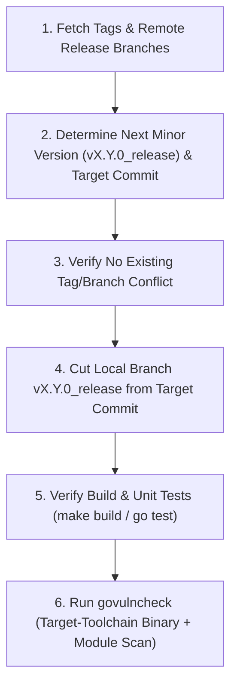

# GCSFuse Minor Release Branch Creation Skill

This skill provides a standardized, end-to-end workflow for cutting a new minor release branch (`v<major>.<minor>.0_release`, e.g., `v3.13.0_release`) for GCSFuse from `master` or a specified commit hash. It covers next minor version discovery, source commit validation, local release branch creation (without pushing to remote), build and unit test verification, and target-toolchain `govulncheck` verification to ensure the new release stream starts with zero CVEs.

## Related Skills
- **[GCSFuse Build and Style Verification Skill](../build/SKILL.md)**: Local compilation, formatting, and static analysis verification via `make build`.
- **[GCSFuse Dependency Upgrading Skill](../dep-upgrade/SKILL.md)**: Upgrading Go module dependencies and Go toolchain versions if `govulncheck` detects vulnerabilities before cutting the release branch.
- **[GCSFuse Release Branch CVE Patching Skill](../cve-patching/SKILL.md)**: Creating subsequent patch release branches (`v<major>.<minor>.<N+1>_release` from `v<major>.<minor>.<N>_release`) and remediating CVEs on existing release streams.
- **[GCSFuse Pull Request Creation Skill](../pull-request/SKILL.md)**: Raising a PR if any pre-cut fixes or CVE remediations are needed before finalizing the release branch.



---

## Phase 1: Version & Source Commit Discovery

### 1.1 Fetch Latest Tags and Remote Branches
Always start by synchronizing local refs with `origin`:
```bash
git fetch origin --tags --prune
```

### 1.2 Determine the Next Minor Release Version (`v<major>.<minor>.0`)
1. **If the user explicitly specifies a target minor version** (e.g., `v3.13`, `3.13`, or `v3.13.0`), normalize it to:
   - **Release version**: `v<major>.<minor>.0` (e.g., `v3.13.0`)
   - **Release branch**: `v<major>.<minor>.0_release` (e.g., `v3.13.0_release`)

2. **If the user does not specify a version**, discover the highest existing `<major>.<minor>` release stream from tags and remote `*_release` branches:
   ```bash
   git tag -l "v*.*.*" --sort=-v:refname | head -n 20
   git branch -r --list "origin/v*.*.*_release" --sort=-v:refname | head -n 20
   ```
   Increment `<minor>` by `1` and set the patch version to `0`:
   - Latest minor stream: `v<major>.<M>.*` (e.g., `v3.12.1`)
   - Next minor release version: `v<major>.<M+1>.0` (e.g., `v3.13.0`)
   - Next minor release branch: `v<major>.<M+1>.0_release` (e.g., `v3.13.0_release`)

3. **Check for Existing Tag or Branch Conflicts**:
   Verify that neither the release tag nor the remote/local release branch already exists:
   ```bash
   git tag -l "v<major>.<minor>.0"
   git branch -a --list "*v<major>.<minor>.0_release"
   ```
   > [!IMPORTANT]
   > If `v<major>.<minor>.0` or `origin/v<major>.<minor>.0_release` already exists, **stop immediately** and ask the user whether they meant to cut the next minor version (`v<major>.<minor+1>.0_release`) or a patch release branch (`v<major>.<minor>.<N+1>_release`).

### 1.3 Identify and Validate the Target Source Commit
1. Determine the source commit from which to cut `v<major>.<minor>.0_release`:
   - **User-Specified Commit**: If the user provides a specific commit hash `<commit_sha>` (for example, the most recent commit on `master` that passed the periodic continuous E2E test build at code freeze), resolve its full SHA (`git rev-parse <commit_sha>^{commit}`).
   - **Default (`origin/master`)**: If no commit hash is specified, use the tip of `origin/master` (`git rev-parse origin/master`).

2. Verify that the target commit is a valid ancestor of `origin/master` and inspect its metadata:
   ```bash
   git merge-base --is-ancestor <target_commit> origin/master
   git show -s --format="Commit: %H%nDate:   %ci%nAuthor: %an <%ae>%nTitle:  %s" <target_commit>
   ```

---

## Phase 2: Create the Local Minor Release Branch

1. Ensure the working tree has no uncommitted modifications (`git status --porcelain`).
2. Create and check out the local minor release branch `v<major>.<minor>.0_release` pointing to `<target_commit>`:
   ```bash
   git checkout -b v<major>.<minor>.0_release <target_commit>
   ```
3. Confirm that `HEAD` matches `<target_commit>` exactly:
   ```bash
   git rev-parse HEAD
   ```
4. **Do NOT push `v<major>.<minor>.0_release` to `origin`**: Keep the newly created release branch local only.

---

## Phase 3: Build & Unit Test Verification

Verify that the newly cut release branch compiles cleanly and passes unit tests:

1. **Run Build and Formatting Checks**:
   Follow the [GCSFuse Build and Style Verification Skill](../build/SKILL.md) to verify compilation and code hygiene:
   ```bash
   make build
   ```
   > [!NOTE]
   > In sandboxed or offline environments where `golangci-lint` cannot run, verify compilation and module tidiness directly via `go mod tidy && go build ./...`.

2. **Run Core Unit Tests**:
   ```bash
   go test ./cmd/... ./internal/...
   ```

3. **Verify Working Tree Hygiene**:
   Confirm that building and testing produced no untracked files or unstaged diffs:
   ```bash
   git status --porcelain
   ```

---

## Phase 4: Zero-CVE Verification (`govulncheck`)

Run `govulncheck` on the local minor release branch to ensure it starts with **0 known security vulnerabilities**.

### 4.1 Ensure `govulncheck` Is Available
```bash
if ! command -v govulncheck &> /dev/null; then
  go install golang.org/x/vuln/cmd/govulncheck@latest || true
  export PATH=$PATH:$(go env GOPATH)/bin
fi
```

### 4.2 Binary Scan with Target Go Toolchain (`.go-version`)
Running `govulncheck ./...` in source mode uses the host environment's default `go` binary, which can cause false-positive `stdlib` reports if the host Go version differs from `.go-version`. Always verify the compiled binary built with the branch's exact target Go toolchain:
1. Read the branch's target Go version from `[.go-version](../../../.go-version)` and build a temporary `gcsfuse` binary using that exact toolchain:
   ```bash
   TARGET_GO=$(tr -d '[:space:]' < .go-version)
   GOTOOLCHAIN=go${TARGET_GO} go build -o /tmp/gcsfuse-release-vulncheck .
   ```
2. Run `govulncheck` in binary mode:
   ```bash
   govulncheck -mode=binary /tmp/gcsfuse-release-vulncheck
   ```
   Verify that it exits with code `0` and outputs `No vulnerabilities found.`
3. Remove the temporary binary:
   ```bash
   rm -f /tmp/gcsfuse-release-vulncheck
   ```

### 4.3 Source / Module Dependency Scan
Also run `govulncheck ./...` to check for any non-stdlib module advisories:
- If `govulncheck` detects any fixable `stdlib` or module vulnerabilities (`Fixed in: vX.Y.Z`), **report the findings to the user** and ask whether they want to remediate the CVEs first using the [GCSFuse Dependency Upgrading Skill](../dep-upgrade/SKILL.md) / [GCSFuse Release Branch CVE Patching Skill](../cve-patching/SKILL.md).

---

## Verification Checklist

Before completing the task, verify the following:
- [ ] Latest tags and `origin/v*.*.*_release` branches were fetched and inspected to determine `v<major>.<minor>.0_release` with no naming collisions.
- [ ] Target commit `<target_commit>` was verified as a valid commit on `origin/master`.
- [ ] Local branch `v<major>.<minor>.0_release` points to the exact `<target_commit>` and has **not** been pushed to `origin`.
- [ ] `make build` (or `go build ./...` + `go mod tidy`) and core unit tests (`go test ./cmd/... ./internal/...`) pass with a clean working tree.
- [ ] `govulncheck -mode=binary` compiled with the branch's `.go-version` Go toolchain reports `0` vulnerabilities.
