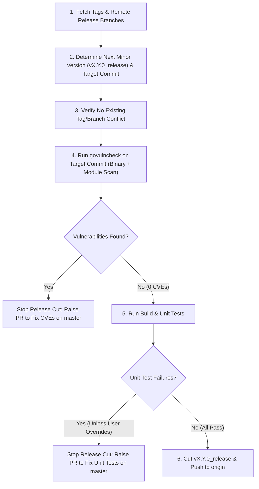

# GCSFuse Minor Release Branch Creation Skill

This skill provides a standardized, end-to-end workflow for cutting a new minor release branch (`v<major>.<minor>.0_release`, e.g., `v3.13.0_release`) for GCSFuse from `master` (or a specified commit hash). Before cutting the release branch, it enforces strict pre-cut health gates on `master`:
1. **Zero-CVE Gate (`govulncheck`)**: If `govulncheck` detects any vulnerabilities on `master`, do **not** cut the release branch; instead, raise a PR against `master` to remediate the vulnerabilities first.
2. **Unit Test Gate (`go test`)**: If any unit test fails (unless the user explicitly specifies otherwise), do **not** cut the release branch; instead, raise a PR against `master` to fix the failing unit test(s) first.
3. **Cut & Push Release Branch**: Only when `master` has zero vulnerabilities and zero unit test failures, cut `v<major>.<minor>.0_release` and push it to `origin`.

## Related Skills
- **[GCSFuse Dependency Upgrading Skill](../dep-upgrade/SKILL.md)**: Upgrading Go module dependencies and Go toolchain versions when `govulncheck` detects vulnerabilities on `master`.
- **[GCSFuse Build and Style Verification Skill](../build/SKILL.md)**: Local compilation, formatting, and static analysis verification via `make build`.
- **[GCSFuse Pull Request Creation Skill](../pull-request/SKILL.md)**: Raising a PR in Draft mode (`--draft`) targeting `master` to fix vulnerabilities or unit test failures discovered during pre-cut verification.
- **[GCSFuse Integration Testing Skill](../integration-tests/SKILL.md)**: Verifying and triggering integration tests when raising remediation PRs against `master`.
- **[GCSFuse Release Branch CVE Patching Skill](../cve-patching/SKILL.md)**: Creating subsequent patch release branches (`v<major>.<minor>.<N+1>_release` from `v<major>.<minor>.<N>_release`) and remediating CVEs on existing release streams.



---

## Phase 1: Version & Source Commit Discovery

### 1.1 Fetch Latest Tags and Remote Branches
Always start by synchronizing local refs with `origin`:
```bash
git fetch origin --tags --prune
```

### 1.2 Determine the Next Minor Release Version (`v<major>.<minor>.0`)
1. **If the user explicitly specifies a target minor version** (e.g., `v3.13`, `3.13`, or `v3.13.0`), normalize it to:
   - **Release version**: `v<major>.<minor>.0` (e.g., `v3.13.0`)
   - **Release branch**: `v<major>.<minor>.0_release` (e.g., `v3.13.0_release`)

2. **If the user does not specify a version**, discover the highest existing `<major>.<minor>` release stream from tags and remote `*_release` branches:
   ```bash
   git tag -l "v*.*.*" --sort=-v:refname | head -n 20
   git branch -r --list "origin/v*.*.*_release" --sort=-v:refname | head -n 20
   ```
   Increment `<minor>` by `1` and set the patch version to `0`:
   - Latest minor stream: `v<major>.<M>.*` (e.g., `v3.12.1`)
   - Next minor release version: `v<major>.<M+1>.0` (e.g., `v3.13.0`)
   - Next minor release branch: `v<major>.<M+1>.0_release` (e.g., `v3.13.0_release`)

3. **Check for Existing Tag or Branch Conflicts**:
   Verify that neither the release tag nor the remote/local release branch already exists:
   ```bash
   git tag -l "v<major>.<minor>.0"
   git branch -a --list "*v<major>.<minor>.0_release"
   ```
   > [!IMPORTANT]
   > If `v<major>.<minor>.0` or `origin/v<major>.<minor>.0_release` already exists, **stop immediately** and ask the user whether they meant to cut the next minor version (`v<major>.<minor+1>.0_release`) or a patch release branch (`v<major>.<minor>.<N+1>_release`).

### 1.3 Identify and Checkout the Target Source Commit
1. Determine the source commit on `master`:
   - **User-Specified Commit**: If the user provides a specific commit hash `<commit_sha>` (for example, the most recent commit on `master` that passed the periodic continuous E2E test build at code freeze), resolve its full SHA (`git rev-parse <commit_sha>^{commit}`).
   - **Default (`origin/master`)**: If no commit hash is specified, use the tip of `origin/master` (`git rev-parse origin/master`).

2. Verify that the target commit is a valid ancestor of `origin/master`, inspect its metadata, and check it out in an isolated `git worktree` for pre-cut verification:
   ```bash
   git merge-base --is-ancestor <target_commit> origin/master
   git show -s --format="Commit: %H%nDate:   %ci%nAuthor: %an <%ae>%nTitle:  %s" <target_commit>
   WT_DIR=$(mktemp -d /tmp/wt_release_check_XXXXXX)
   git worktree add --detach "${WT_DIR}" <target_commit>
   cd "${WT_DIR}"
   ```

---

## Phase 2: Pre-Cut Vulnerability Gate (`govulncheck`)

Before cutting the minor release branch, verify in the isolated `git worktree` (with `GOWORK=off`) that the target commit on `master` has **0 known `Symbol`, `Package`, or fixable tagged `Module` (`Fixed in: <mod>@vX.Y.Z`) security vulnerabilities**.

### 2.1 Ensure `govulncheck` Is Available
```bash
if ! command -v govulncheck &> /dev/null; then
  go install golang.org/x/vuln/cmd/govulncheck@latest
  export PATH=$(go env GOPATH)/bin:$PATH
fi
```

### 2.2 Target-Toolchain Binary Scan (`-mode=binary -show verbose`) & Exit-Code Preservation
Running `govulncheck` in source mode (`govulncheck ./...`) uses the host environment's default `go` binary, which can fail on parent `go.work`/`vendor/` directories (`go: inconsistent vendoring`) or cause false-positive `stdlib` reports if the host Go version differs from `.go-version`. Furthermore, omitting `-show verbose` hides `=== Module Results ===` (which container vulnerability scanners still flag via `go version -m` buildinfo). Always verify the compiled binary built with `GOWORK=off` and the branch's exact target Go toolchain:
1. Read the target Go version from `[.go-version](../../../.go-version)`, build a temporary `gcsfuse` binary with `GOWORK=off` and that exact toolchain, and run `govulncheck -mode=binary -show verbose`:
   ```bash
   TMP_DIR=$(mktemp -d)
   TARGET_GO=$(tr -d '[:space:]' < .go-version)
   GOWORK=off GOTOOLCHAIN=go${TARGET_GO} go build -o "${TMP_DIR}/gcsfuse-release-vulncheck" .
   govulncheck -mode=binary -show verbose "${TMP_DIR}/gcsfuse-release-vulncheck"
   ```
   > [!CAUTION]
   > **Strict Exit-Code Preservation**:
   > **NEVER** append `; rm -rf "${TMP_DIR}"` on the same command line after `govulncheck` without `set -e`, because `rm` overwrites `govulncheck`'s non-zero exit code (`3`) with `0`. Always run `govulncheck` as the final command in the step so any non-zero exit code fails visibly.
2. Inspect both the exit status and `-show verbose` output sections:
   - Verify `=== Symbol Results ===` reports `No vulnerabilities found.` (and exit code is `0`).
   - Verify `=== Package Results ===` reports `No other vulnerabilities found.` / `No vulnerabilities found.`
   - Inspect `=== Module Results ===` and verify **no** module advisories have a published tagged release fix (`Fixed in: <mod>@vX.Y.Z` without a `-0.<timestamp>-<commit>` pseudo-version suffix; module-only notices with `Fixed in: N/A` or untagged pseudo-versions like `GO-2026-5932` in unimported `golang.org/x/crypto/openpgp` are non-blocking once confirmed unimported via `GOWORK=off go list -deps ./... | grep <pkg>`).
3. Remove the temporary directory in a separate step after inspecting the output:
   ```bash
   rm -rf "${TMP_DIR}"
   ```

### 2.3 Gate Action: If Vulnerabilities Are Found, Fix `master` First
> [!IMPORTANT]
> **Do NOT cut `v<major>.<minor>.0_release` if `govulncheck -mode=binary -show verbose` reports any `Symbol`, `Package`, or fixable tagged `Module` vulnerabilities (`Fixed in: <mod>@vX.Y.Z`).**
> Because a new minor release branch is cut from `master`, `master` itself must be remediated first.

If vulnerabilities are detected:
1. **Stop the release branch creation workflow.** Do not create or push `v<major>.<minor>.0_release`.
2. Create a remediation branch from `origin/master` in an isolated worktree (e.g., `git worktree add -b fix-cve-master /tmp/wt_fix_cve_master origin/master`).
3. Follow the [GCSFuse Dependency Upgrading Skill](../dep-upgrade/SKILL.md) to upgrade the affected Go modules and/or Go toolchain across the repository (remembering to ask the user for confirmation before upgrading the Go compiler version or performing a major module version upgrade).
4. Re-verify in a fresh temporary directory (`TMP_DIR=$(mktemp -d) && TARGET_GO=$(tr -d '[:space:]' < .go-version) && GOWORK=off GOTOOLCHAIN=go${TARGET_GO} go build -o "${TMP_DIR}/gcsfuse-release-vulncheck" . && govulncheck -mode=binary -show verbose "${TMP_DIR}/gcsfuse-release-vulncheck"`) that `0` `Symbol`, `Package`, and fixable tagged `Module` (`Fixed in: <mod>@vX.Y.Z`) vulnerabilities remain, then remove `${TMP_DIR}` in a separate step.
5. Follow the [GCSFuse Build and Style Verification Skill](../build/SKILL.md) (`make build`), the [GCSFuse Integration Testing Skill](../integration-tests/SKILL.md) safety rules (never run integration tests on Cloudtop; trigger via `execute-integration-tests` and `execute-perf-test` PR labels), and the [GCSFuse Pull Request Creation Skill](../pull-request/SKILL.md) to push the remediation branch and **raise a Draft Pull Request (`--draft`) targeting `master`**.
6. Report the PR link to the user and stop; the minor release branch should be cut after the `master` remediation PR is merged.

---

## Phase 3: Pre-Cut Build & Unit Test Gate

Once `govulncheck` passes with `0` vulnerabilities, verify that the target commit compiles cleanly and passes all unit tests.

### 3.1 Run Build and Formatting Checks
Follow the [GCSFuse Build and Style Verification Skill](../build/SKILL.md) to verify compilation and code hygiene:
```bash
TARGET_GO=$(tr -d '[:space:]' < .go-version)
GOWORK=off GOTOOLCHAIN=go${TARGET_GO} make build
```
> [!NOTE]
> In sandboxed or offline environments where `golangci-lint` or network-dependent `go generate` tools cannot run, verify compilation and module tidiness directly via:
> ```bash
> TARGET_GO=$(tr -d '[:space:]' < .go-version)
> GOWORK=off GOTOOLCHAIN=go${TARGET_GO} go mod tidy
> GOWORK=off GOTOOLCHAIN=go${TARGET_GO} go build ./...
> ```

### 3.2 Run Unit Tests
Run the unit test suite across the repository (excluding `tools/integration_tests`, which must never run locally on Cloudtop):
```bash
TARGET_GO=$(tr -d '[:space:]' < .go-version)
CGO_ENABLED=0 GOWORK=off GOTOOLCHAIN=go${TARGET_GO} go test `GOWORK=off go list ./... | grep -v 'tools/integration_tests'`
```

### 3.3 Gate Action: If Unit Tests Fail, Raise a PR to Fix `master` First
> [!IMPORTANT]
> **Do NOT cut `v<major>.<minor>.0_release` if unit test failures are detected**, unless the user has explicitly instructed to ignore or bypass specific test failures.

If one or more unit tests fail (and no user override was given):
1. **Stop the release branch creation workflow.** Do not create or push `v<major>.<minor>.0_release`.
2. Create a bug-fix branch from `origin/master` in an isolated worktree (e.g., `git worktree add -b fix-unit-tests-master /tmp/wt_fix_unit_tests origin/master`).
3. Diagnose and fix the failing unit test(s) or underlying regression, and re-run `make build` and the unit tests until they pass cleanly.
4. Follow the [GCSFuse Build and Style Verification Skill](../build/SKILL.md) (`make build`), the [GCSFuse Integration Testing Skill](../integration-tests/SKILL.md) safety rules (trigger CI suites via `execute-integration-tests` and `execute-perf-test` PR labels), and the [GCSFuse Pull Request Creation Skill](../pull-request/SKILL.md) to push the fix branch and **raise a Draft Pull Request (`--draft`) targeting `master`**.
5. Report the failing test details and PR link to the user and stop; the minor release branch should be cut once the fix PR is merged into `master`.

---

## Phase 4: Cut and Push the Minor Release Branch

Proceed to this phase **only when both Phase 2 (`govulncheck` = 0 vulnerabilities) and Phase 3 (`go test` = 0 failures) pass cleanly**:

1. **Verify Working Tree Hygiene**:
   Confirm that building and testing produced no untracked files or unstaged diffs:
   ```bash
   git status --porcelain
   ```

2. **Create and Push the Minor Release Branch (`v<major>.<minor>.0_release`)**:
   Create `v<major>.<minor>.0_release` pointing to `<target_commit>`, push it to `origin`, verify the remote ref, and clean up the temporary worktree:
   ```bash
   git checkout -b v<major>.<minor>.0_release <target_commit>
   git rev-parse HEAD
   git push -u origin v<major>.<minor>.0_release
   git ls-remote --heads origin v<major>.<minor>.0_release
   cd - && git worktree remove "${WT_DIR}"
   ```

---

## Verification Checklist

Before completing the task, verify the following:
- [ ] Latest tags and `origin/v*.*.*_release` branches were fetched and inspected to determine `v<major>.<minor>.0_release` with no naming collisions.
- [ ] Target commit `<target_commit>` was verified as a valid commit on `origin/master`.
- [ ] `GOWORK=off GOTOOLCHAIN=go$(tr -d '[:space:]' < .go-version) go build -o "${TMP_DIR}/gcsfuse-release-vulncheck" .` and `govulncheck -mode=binary -show verbose "${TMP_DIR}/gcsfuse-release-vulncheck"` (run without trailing `; rm -rf`) were executed:
  - If any `Symbol`, `Package`, or fixable tagged `Module` (`Fixed in: <mod>@vX.Y.Z`) vulnerabilities were found: `v<major>.<minor>.0_release` was **not** created, and a remediation PR targeting `master` was raised following `/gcsfuse-build`, `/gcsfuse-pull-request` (`--draft`), and `/gcsfuse-integration-testing`.
- [ ] Build (`make build` or `go build ./...`) and unit tests (`go test`) were executed:
  - If unit tests failed (without user override): `v<major>.<minor>.0_release` was **not** created, and a fix PR targeting `master` was raised following `/gcsfuse-build`, `/gcsfuse-pull-request` (`--draft`), and `/gcsfuse-integration-testing`.
- [ ] Only if `0` vulnerabilities and `0` unit test failures were found: `v<major>.<minor>.0_release` was created from `<target_commit>` and pushed to `origin` (unless the user explicitly requested local-only).
